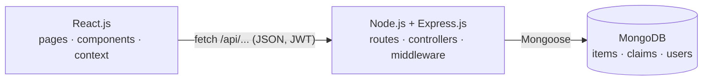

# 🔎 Smart Lost & Found
### College Campus Lost & Found Management System

A full-stack **React.js → Node.js/Express.js → MongoDB** project (3rd-year B.Tech CSE) that manages the **complete lost-and-found lifecycle** on a college campus: reporting, searching, smart matching, ownership claims, verification by the DOSS office, collection and case closure.

> React 19 · Vite · React Router · Node.js · Express 5 · MongoDB (Mongoose) · REST API · JWT login for DOSS staff
>
> 📄 [Architecture](docs/ARCHITECTURE.md) · [Database design](docs/DATABASE.md) · [API details](docs/API.md) · [Team roles](docs/TEAM_ROLES.md) · [Screenshots](docs/SCREENSHOTS.md)

---

## Contents

- [⚡ Quick demo (5 minutes)](#quick-demo-5-minutes)
- [1. Problem statement](#1-problem-statement)
- [2. Objective](#2-objective)
- [3. Features](#3-features)
  - [Keyboard Shortcuts & Accessibility](#keyboard-shortcuts--accessibility)
- [4. Student workflow](#4-student-workflow)
- [5. DOSS workflow](#5-doss-workflow)
- [6. Technology stack](#6-technology-stack)
- [7. Architecture](#7-architecture)
  - [Privacy Boundary & Field Exposure](#privacy-boundary--field-exposure)
- [8. Folder structure](#8-folder-structure)
- [9. Smart Match algorithm (`src/utils/matching.js`)](#9-smart-match-algorithm-srcutilsmatchingjs)
- [10. Data flow example: "Accept claim"](#10-data-flow-example-accept-claim)
- [11. Data storage](#11-data-storage)
- [12. JavaScript & React concepts](#12-javascript--react-concepts)
- [13. Installation & running](#13-installation--running)
  - [Troubleshooting](#troubleshooting)
  - [Contributing & Development Guidelines](#contributing--development-guidelines)
- [14. Limitations](#14-limitations)
- [15. Future improvements](#15-future-improvements)
- [16. Viva questions](#16-viva-questions)

## ⚡ Quick demo (5 minutes)

The sample data is set up so you can show the whole workflow straight away:

| Step | Mode | Do this | You should see |
|---|---|---|---|
| 1 | Student | **Found Items → Black iPhone → This is my item** | The claim form |
| 2 | Student | Unique feature: *"There are three small scratches on the bottom-right corner of the back case."* Link the lost report **iPhone 15**, then submit | **Claim pending** |
| 3 | DOSS | **Dashboard → Pending claims → Black iPhone** | Claim Review with **Strong evidence** |
| 4 | DOSS | **Accept claim** → confirm | **Ready for collection** |
| 5 | Student | **My Claims** | "Claim accepted" + Collection instructions |
| 6 | DOSS | **Mark as collected** → **Mark as resolved** | The case appears in **Resolved** |
| 7 | Any | Refresh the page, or open `mongosh` → `db.claims.find()` | Everything is stored in MongoDB |

**Smart Match:** open **Smart Match → Leather Wallet** to see an 84% match with every factor explained.

**Weak claim:** in DOSS mode, claim **CL-3003** (black wallet) shows **Weak evidence**. That is why it was rejected.

To start over: **DOSS Dashboard → Reset demo data**.

## 1. Problem statement

Students lose phones, ID cards, wallets, keys, laptops and books on campus every day. Today this is handled through WhatsApp groups and notice boards:

- Posts get buried, so owners never see that their item was found.
- There is no search, and nobody compares "lost" posts with "found" posts.
- **Anyone can say "that's mine"**. There is no check that the person claiming an item is the real owner.
- The office that keeps found items (DOSS) has no record of who collected what, or when.

## 2. Objective

Build a working web application where:

1. Students report lost and found items, keeping some **identifying details private**.
2. Anyone can search, filter and sort reports.
3. A **Smart Match** algorithm (plain JavaScript) scores how likely a lost and a found report are the same item.
4. A student who sees their item submits an **ownership claim with proof**.
5. **DOSS** compares the claim with the private details, then **accepts or rejects** it.
6. The student sees the result and **collection instructions**. DOSS marks the item **collected**, then **resolved**.

## 3. Features

| Area | Features |
|---|---|
| **Mode switch** | `[ STUDENT ] [ DOSS ]` toggle in the top bar. Students need no account; **DOSS asks for a staff login** (JWT). |
| **Home** | Google-style hero with a large search box, Report Lost / Report Found buttons, live statistics, rotating campus tips (`fetch` + `setInterval`), recent lost & found items, possible matches, My Claims (student) / Pending Claims (DOSS). |
| **Report forms** | Controlled inputs, live validation with regular expressions, image upload with preview and compression (FileReader + canvas), **private verification details**, auto-saved draft, success screen and redirect. |
| **Lost / Found lists** | Debounced search, filters (category, location, date, status), sorting (Newest, Oldest, A–Z, Z–A), skeleton loading, empty states. Private details are never searchable. |
| **Item details** | Public details. DOSS mode also shows private details, the claims for this item and actions (mark collected / resolved / delete). |
| **Claim system** | "This is my item" → claim form (why it's yours, unique feature not publicly mentioned, where & when you lost it, extra proof, optional link to your lost report). Status becomes **CLAIM_PENDING**, never auto-approved. |
| **My Claims** | Progress tracker (Submitted → Accepted → Collected → Resolved), accepted / rejected messages, collection instructions, "track by claim ID". |
| **DOSS dashboard** | 9 live statistics, pending-claims queue, ready-for-collection list, recovery-rate donut, 7-day chart, category chart, Smart Match suggestions, recent-activity timeline, reset demo data. |
| **Claim review** | Found report, linked lost report, the claimant's answers and all private details side by side, plus a **verification helper** that scores the evidence. Accept (with confirmation modal) or Reject (a reason is required). |
| **Collection** | Mark as collected (timestamp saved) → Mark as resolved (closes the found item, the linked lost report and the claim). |
| **Resolved cases** | Table of collected / resolved cases with who collected them and when. |
| **Smart Match** | 0–100 score, "✓ Same category / ✓ Same colour…" factors, sorted highest first, minimum-score slider. |
| **UX** | Google-inspired design, toasts (snackbars), confirmation modals, loading & empty states, responsive layout, keyboard support (`/` to search, `Esc` closes dialogs). |

### Keyboard Shortcuts & Accessibility

| Key / Shortcut | Context | Action |
|---|---|---|
| `/` | Anywhere (when not inside an input) | Immediately focuses the main search bar |
| `Escape` | Inside search bar | Clears search query and restores full list |
| `Escape` | Inside any confirmation modal | Closes the modal dialog safely |
| `Tab` / `Shift+Tab` | Modals and forms | Accessible logical tab order and focus trapping |
| Skip link | Top of document | Allows keyboard/screen-reader users to skip straight to `#main` content |

## 4. Student workflow

```
Report Lost Item ──► status LOST
                         │
          (someone else) Report Found Item ──► status FOUND
                         │
     Student opens the found item ──► [ THIS IS MY ITEM ]
                         │
            Claim form with proof ──► CLAIM_PENDING   (nothing is approved automatically)
                         │
          My Claims shows ──► Claim accepted / Claim rejected
                         │
       If accepted ──► READY_FOR_COLLECTION + collection instructions
                         │ (student goes to the DOSS office with their ID)
                    COLLECTED ──► RESOLVED
```

Try it with the sample data: open **Found Items → Black iPhone → This is my item**. For the unique feature, write *"There are three small scratches on the bottom-right corner of the back case."*

## 5. DOSS workflow

1. Switch to **DOSS** mode and sign in on the DOSS tab (`doss@college.edu` / `Doss@123`). The dashboard shows *Pending claims: 3*.
2. Open a claim → **Claim Review** page.
3. Compare: found report (with the finder's private notes) · lost report (with the owner's private notes) · claimant's answers · verification helper.
4. **Accept claim** → "Are you sure you want to accept this ownership claim?" → the item becomes **READY_FOR_COLLECTION**. Other pending claims for the same item are rejected automatically.
   *or* **Reject claim** → a reason is required → the item goes back to **FOUND**.
5. When the student collects the item: **Mark as collected** (date and time saved) → **COLLECTED**.
6. **Mark as resolved** → **RESOLVED**. The case appears under **Resolved cases**.

### Status reference

| Status | Colour | Meaning |
|---|---|---|
| `LOST` | Blue | Lost report, not found yet |
| `FOUND` | Green | Found item waiting for its owner |
| `CLAIM_PENDING` | Yellow | Someone claimed it, DOSS is reviewing |
| `CLAIM_ACCEPTED` | Green | (claim) DOSS verified the owner |
| `CLAIM_REJECTED` | Red | (claim) Proof did not match |
| `READY_FOR_COLLECTION` | Blue | (item) Waiting at the DOSS office |
| `COLLECTED` | Green | Owner picked it up |
| `RESOLVED` | Green | Case closed |

Items and claims each have their own status. `CLAIM_ACCEPTED` / `CLAIM_REJECTED` belong to a **claim**, and `READY_FOR_COLLECTION` belongs to an **item**.

#### State Transition Matrix

| Trigger / Action | Item Status Change | Claim Status Change | Notes |
|---|---|---|---|
| User reports lost item | `-> LOST` | N/A | Available for matching |
| User reports found item | `-> FOUND` | N/A | Available for claim |
| Student submits claim | `FOUND -> CLAIM_PENDING` | `-> CLAIM_PENDING` | Item locked from collection |
| DOSS accepts claim | `CLAIM_PENDING -> READY_FOR_COLLECTION` | `CLAIM_PENDING -> CLAIM_ACCEPTED` | Competing claims set to `CLAIM_REJECTED` |
| DOSS rejects claim | `CLAIM_PENDING -> FOUND` (or remains `CLAIM_PENDING` if other claims exist) | `CLAIM_PENDING -> CLAIM_REJECTED` | Requires review note |
| Owner collects item | `READY_FOR_COLLECTION -> COLLECTED` | `CLAIM_ACCEPTED -> COLLECTED` | Student ID verified by DOSS staff |
| DOSS closes case | `COLLECTED -> RESOLVED` | `COLLECTED -> RESOLVED` | Case archived into Resolved Cases |

## 6. Technology stack

| Layer | Technology | Use |
|---|---|---|
| Frontend | **React 19**, React Router 7, Vite | Pages, components, hooks, routing, dev server |
| Frontend | JavaScript ES6+, HTML5, CSS3 | All logic (no TypeScript), Google-inspired design system |
| Backend | **Node.js + Express 5** | REST API, middleware, business rules (`server/`) |
| Database | **MongoDB 8 + Mongoose 9** | Collections `items`, `claims`, `users`, `counters` |
| Auth | JSON Web Tokens + bcrypt | DOSS staff login; students need no account |
| Testing | Node test runner + supertest | 17 API tests (`server/test`) + frontend unit tests (`test/`) |
| Tooling | concurrently, dotenv, morgan, oxlint | One `npm run dev`, config in `.env`, request logs, linting |
| Assets | `material-symbols`, `@fontsource/roboto` | Icons and font bundled locally (work offline) |

## 7. Architecture



- **React** (`src/`) only shows data and collects input. `src/services/apiClient.js` is the one place that calls the API.
- **Express** (`server/src/`) exposes the REST API, checks the JWT for DOSS routes, validates input and runs the claim workflow (`services/claimWorkflow.js`).
- **MongoDB** stores everything; the Mongoose schemas in `server/src/models/` define the database design and validation.

Full diagrams (layers and a request sequence): **[docs/ARCHITECTURE.md](docs/ARCHITECTURE.md)**.

### Privacy Boundary & Field Exposure

These rules are enforced by the **server**: `privateDetails` has `select: false` in MongoDB, and public claim responses leave out personal fields.

| Field | Public Cards & Lists | Search Engine (`SEARCHABLE_FIELDS`) | Student Details View | DOSS Staff View |
|---|---|---|---|---|
| `name`, `category`, `color`, `location` | Yes | Yes | Yes | Yes |
| `description` | Yes | Yes | Yes | Yes |
| `contactName`, `contact` | No | No | Yes | Yes |
| `privateDetails` | **Never** | **Never** | **Hidden** | **Visible for Verification** |
| `claimantName`, `rollNumber` | No | No | Owner Only (My Claims) | Yes (DOSS Queue) |
| `uniqueFeature` | No | No | Owner Only | Yes (Side-by-side Review) |

## 8. Folder structure

```
lost_and_found/
├── index.html
├── public/
│   ├── favicon.svg
│   └── data/campus-tips.json          ← loaded with fetch()
└── src/
    ├── main.jsx                       ← Router + providers + fonts
    ├── App.jsx                        ← all routes
    ├── index.css                      ← design system, animations, responsive rules
    ├── assets/logo.svg
    ├── components/
    │   ├── Navbar  ModeSwitcher  ModeGate  Footer  PageHeader  ScrollToTop  Icon
    │   ├── ItemCard  ItemImage  StatusBadge  SearchBar  FilterPanel  ItemsBrowser
    │   ├── ItemForm  FormField  ImageUploader  ReportLayout
    │   ├── ClaimForm  ClaimCard  ClaimTimeline  ClaimReview  CollectionInstructions
    │   ├── MatchCard  MatchPairList  ScoreRing  BarChart  StatCard  DashboardCard
    │   └── Modal  Notification  LoadingSpinner  EmptyState  TipTicker
    ├── pages/
    │   ├── Home  LostItems  FoundItems  ReportLost  ReportFound  ItemDetails
    │   ├── ClaimItem  MyClaims  SmartMatch  StudentDashboard
    │   └── DossDashboard  DossClaims  ClaimReview  ResolvedItems  NotFound
    ├── context/     ItemContext.jsx  AuthContext.jsx  ModeContext.jsx  NotificationContext.jsx
    ├── hooks/       useLocalStorage.js  useDebounce.js  useFormState.js  useDocumentTitle.js
    ├── services/    apiClient.js  itemService.js  authService.js
    ├── utils/       matching.js  claimUtils.js  validation.js  searchUtils.js  statistics.js
    │                dateUtils.js  storage.js  imageUtils.js  helpers.js
    └── data/        constants.js

server/                                ← Node.js + Express + MongoDB API
├── .env.example                       ← copy to .env (PORT, MONGODB_URI, JWT_SECRET …)
├── src/
│   ├── index.js                       ← connect MongoDB → listen on 5050
│   ├── app.js                         ← Express app: CORS, JSON, routes, errors
│   ├── config/      env.js  db.js  constants.js
│   ├── models/      Item.js  Claim.js  User.js  Counter.js
│   ├── routes/      index.js  itemRoutes.js  claimRoutes.js
│   ├── controllers/ itemController  claimController  authController  statsController  adminController
│   ├── services/    claimWorkflow.js   ← claim lifecycle rules
│   ├── middleware/  auth.js (JWT)  errorHandler.js
│   ├── seed/        seed.js  seedDatabase.js  sampleItems.js (25)  sampleClaims.js (7)
│   └── utils/       dates.js  HttpError.js  pick.js
└── test/api.test.js                   ← 17 API integration tests

docs/   ARCHITECTURE.md  DATABASE.md  API.md  TEAM_ROLES.md  SCREENSHOTS.md
```

### Routes

| Route | Page | Mode |
|---|---|---|
| `/` | Home | both |
| `/lost`, `/found` | Lost / Found lists | both |
| `/items/:id` | Item details | both (DOSS sees private info) |
| `/smart-match`, `/smart-match/:id` | Smart Match | both |
| `/dashboard` | StudentDashboard **or** DossDashboard | depends on mode |
| `/resolved` | Resolved cases | both |
| `/report-lost`, `/report-found` | Report forms | Student |
| `/items/:id/claim` | Claim form | Student |
| `/my-claims` | My claims | Student |
| `/doss/claims` | Claims queue | DOSS |
| `/doss/claims/:claimId` | Claim Review | DOSS |

## 9. Smart Match algorithm (`src/utils/matching.js`)

`calculateMatchScore(lostItem, foundItem)` returns **0–100**. Each factor gives a ratio from 0 to 1, which is multiplied by its weight:

| Factor | Weight | How the ratio is calculated |
|---|---|---|
| Category | 20 | same → 1, else 0 |
| Item name | 25 | keyword similarity of the names |
| Colour | 15 | same → 1; a shared word ("Dark Blue" / "Blue") → 0.5 |
| Location | 20 | same → 1; a **nearby** place (`NEARBY_LOCATIONS` table) → 0.5 |
| Date | 10 | ≤1 day → 1, ≤3 → 0.7, ≤7 → 0.4, ≤14 → 0.2; found long *before* it was lost → 0 |
| Description | 10 | keyword similarity of the descriptions |

#### Match Score Levels

| Score Range | Classification | Tone | Notes |
|---|---|---|---|
| `75% – 100%` | **Strong match** | Green / High | High confidence across category, name, location, and date |
| `50% – 74%` | **Good match** | Yellow / Medium | Shares multiple key attributes with minor variances |
| `35% – 49%` | **Possible match** | Blue / Low | Minimum default display threshold (`DEFAULT_MATCH_THRESHOLD`) |
| `< 35%` | Hidden by default | Neutral | Accessible via the minimum-score slider set to 0% |

**Keyword similarity:**

1. `extractKeywords()` lower-cases the text, removes punctuation with `/[^a-z0-9\s]/g`, splits on spaces, drops stop-words and removes duplicates with `new Set`.
2. `getCommonKeywords()` finds shared words ("phone" ≈ "iphone").
3. The ratio is `common ÷ shorter list length`.

**Worked example.** Lost "Leather Wallet" vs found "Brown Wallet":

| Factor | Points | Why |
|---|---|---|
| Category | 20 | Both are Wallets |
| Name | 13 | "wallet" shared, 1 of 2 words |
| Colour | 15 | Brown = Brown |
| Location | 20 | Cafeteria = Cafeteria |
| Date | 10 | 1 day apart |
| Description | 6 | brown, leather, wallet |
| **Total** | **84% Match** | |

`findMatches(item, allItems, minScore)` works from either side (lost → found, found → lost). It only compares **open** reports: `filter → map(score) → filter(≥ threshold) → sort(desc)`.

### Claim verification helper (`src/utils/claimUtils.js → verifyClaim`)

This helps DOSS decide; it never decides automatically. It checks:

| Check | Weight | How |
|---|---|---|
| The claimant's unique feature vs the **private details** of the found and lost reports | 50 | keyword overlap |
| Location consistent | 20 | same place or nearby |
| Dates consistent | 15 | lost before found, within 14 days |
| Linked lost report exists and matches | 15 | Smart Match ≥ 50 |

It returns *Strong / Some / Weak evidence* with a percentage.

## 10. Data flow example: "Accept claim"

1. `ClaimReview.jsx` shows a confirmation modal. On confirm it calls `acceptClaim(claimId, note)` from `ItemContext`.
2. `itemService.acceptClaim()` sends `POST /api/claims/:id/accept` with the DOSS JWT (`apiClient.js`).
3. Express runs `requireDoss` (checks the token), then `claimWorkflow.acceptClaim()`:
   - claim → `CLAIM_ACCEPTED` with `acceptedAt`
   - found item and linked lost report → `READY_FOR_COLLECTION`
   - other pending claims on the same item → `CLAIM_REJECTED`
4. Mongoose saves the documents in MongoDB and the API returns `{ items, claims }`, only the documents that changed.
5. `ItemContext` merges them into state (`mergeUpdates` uses `reduce`). Every page using `useItems()` re-renders.
6. A toast says "Claim accepted by DOSS."

## 11. Data storage

**MongoDB** holds all shared data: reports, claims, DOSS accounts and ID counters. See **[docs/DATABASE.md](docs/DATABASE.md)** for the ER diagram, every field and every index. Refreshing the page or opening the app on another computer shows the same data.

The **browser** keeps only small per-user settings with `useLocalStorage` (JSON in `localStorage` / `sessionStorage`):

| Key | Contents |
|---|---|
| `lf_v2_token` | DOSS login token (JWT), removed on logout |
| `lf_v2_mode` | `"student"` / `"doss"` |
| `lf_v2_my_claims` | IDs of claims made from this browser (students have no account) |
| `lf_v2_draft_lost` / `_found` | unsaved report form (removed after submit) |
| `lf_v2_filters_lost` / `_found` | search / filter / sort (**sessionStorage**) |
| `lf_v2_view`, `lf_v2_recent` | grid/list choice, recently viewed items |

**Reset demo data** (DOSS dashboard) calls `POST /api/admin/reset`, which re-seeds MongoDB.

## 12. JavaScript & React concepts

- **[JAVASCRIPT_CONCEPTS.md](JAVASCRIPT_CONCEPTS.md)**: every concept, with the file, why it is used, and a small example.
- **[REACT_CONCEPTS.md](REACT_CONCEPTS.md)**: every React concept and exactly where it is used.

## 13. Installation & running

Requirements: **Node.js 18+**, npm, and **MongoDB** running locally (or a MongoDB Atlas connection string).

```bash
git clone https://github.com/madhusudhan1260/smart-lost-and-found.git
cd smart-lost-and-found

npm run setup      # installs frontend + server packages and seeds MongoDB
npm run dev        # starts the API (http://localhost:5050) and React (http://localhost:5173)
```

Optional: copy `server/.env.example` to `server/.env` to change the port, the MongoDB URI (e.g. Atlas), the JWT secret or the DOSS account.

**Sign in** at http://localhost:5173/login – one page with a tab for each role (each tab has a *Use demo* button):

| Tab | Demo account | Lands on |
|---|---|---|
| Student | `student@college.edu` / `Student@123` (or *Create an account*) | Student dashboard |
| DOSS staff | `doss@college.edu` / `Doss@123` | DOSS dashboard |
| Super Admin | `admin@college.edu` / `Admin@123` | Manage accounts (`/admin/users`) |

Guests can still browse, report and claim without signing in.

| Command (project root) | Purpose |
|---|---|
| `npm run dev` | API + React together (`concurrently`) |
| `npm run dev:server` / `npm run dev:client` | Only one of them |
| `npm run seed` | Reset MongoDB to the sample data |
| `npm run test:server` | 17 API integration tests (needs MongoDB) |
| `npm test` | Frontend unit tests |
| `npm run build` | Production build of the React app into `dist/` |
| `npm run lint` | oxlint |

Installing MongoDB on macOS: `brew tap mongodb/brew && brew install mongodb-community && brew services start mongodb-community`. On Windows use the MongoDB Community installer, or use a free MongoDB Atlas cluster and put its URI in `server/.env`.

### Troubleshooting

- **"Cannot reach the server" banner:** the API is not running. Start everything with `npm run dev` and check the `[api]` lines.
- **`Could not start the API … Is MongoDB running?`:** start MongoDB (`brew services start mongodb-community`) or fix `MONGODB_URI` in `server/.env`.
- **Port 5050 in use:** set `PORT=5051` in `server/.env` and change the proxy in `vite.config.js`.

- **Port in use (`EADDRINUSE: 5173`):** Vite will automatically select the next available port (e.g., `5174`). You can force a specific port using `npx vite --port 3000`.
- **Odd browser state:** Open Developer Tools (`F12`) → Application → Local Storage → Clear all entries (this only clears settings; data is in MongoDB), or click **Reset demo data** on the DOSS Dashboard.
- **Node version mismatch:** Ensure `node -v` prints `v18.0.0` or higher. Use `nvm use 18` or `nvm use 20` if installed.
- **Build cache clean:** If changes are not reflected, run `rm -rf node_modules/.vite dist` and restart with `npm run dev`.

### Contributing & Development Guidelines

1. **Pure ES6+ JavaScript:** All app and business logic is written in plain JavaScript with modern ES6+ features (destructuring, arrow functions, async/await).
2. **Modular Architecture:** Keep business rules in `src/utils/` as standalone pure functions without React dependencies.
3. **No Heavy UI Libraries:** UI styling relies on hand-crafted Google-inspired CSS tokens in `src/index.css`.
4. **Conventional Commits:** Prefix all commit messages with conventional types (`docs:`, `fix:`, `feat:`, `refactor:`, `test:`, `a11y:`, `perf:`).
5. **Quality Verification:** Always run `npm run lint` and `npm run build` to confirm zero errors and successful production build before submitting changes.

## 14. Limitations

- Students have no accounts: "My Claims" is remembered per browser (claim IDs), with "track by claim ID" as a fallback.
- One DOSS role only; there is no admin screen for managing staff accounts (they are created by the seed script).
- Photos are stored inside MongoDB documents as compressed data URLs, which is fine for a campus demo but not for thousands of photos.
- Smart Match and the verification helper use keyword overlap and do not understand synonyms ("cellphone" vs "mobile").
- No e-mail/SMS notifications yet.

## 15. Future improvements

- Deploy: API on Render/Railway, database on MongoDB Atlas, React on Vercel/Netlify (`VITE_API_URL`)
- Store photos in object storage (e.g. Cloudinary) instead of inside documents
- College SSO login with real roles (student / DOSS staff)
- Email / SMS notifications when a claim is accepted or a strong match appears
- A QR code on the collection slip, scanned at the DOSS counter
- A synonym dictionary and fuzzy matching (Levenshtein distance) for Smart Match
- Image similarity as an extra match factor
- Audit log / export of resolved cases for the DOSS office (CSV / PDF)
- Unit tests for `utils/` with Vitest

## 16. Viva questions

**Q1. Is the Student/DOSS switch a login?**
Students need no account. Switching to DOSS opens a login dialog; `POST /api/auth/login` checks the bcrypt hash and returns a JWT. DOSS-only routes (accept, reject, collect, resolve, delete) are protected on the server by the `requireDoss` middleware, so hiding buttons is not the only protection.

**Q2. Why keep some details private?**
If every detail were public, anyone could copy them into a claim. The owner (in the lost report) and the finder (in the found report) each keep private details. Only DOSS sees them, and it compares them with the claimant's answer.

**Q3. Why isn't a claim approved automatically?**
Ownership affects valuables such as phones and wallets. The verification helper only *suggests* evidence strength, and a DOSS staff member makes the decision. That is the human-in-the-loop part of the design.

**Q4. What happens when two students claim the same item?**
Both claims are `CLAIM_PENDING`. When DOSS accepts one, `acceptClaim` uses `filter()` to find the others and rejects them with the note "Another claim for this item was verified by DOSS."

**Q5. Explain `calculateMatchScore`.**
It compares six factors. Each gives a ratio from 0 to 1, which is multiplied by its weight (20/25/15/20/10/10), and the points are added with `reduce`. See section 9.

**Q6. Where do you use `async/await`?**
Every API call: `itemService` functions return Promises from `fetch()` (via `apiClient.request`), and the context and forms `await` them inside `try/catch/finally` to show loading states, server validation errors and toasts. On the server, every controller is an `async` function that awaits Mongoose queries.

**Q7. Where is `Promise.all` used?**
`ItemContext.loadData` fetches items and claims in parallel, and the server's `saveAll()` saves several changed documents at once.

**Q8. What is debouncing?**
It waits until the user stops typing before running the search. `useDebounce` starts a `setTimeout` on every keystroke and clears the previous one in the effect cleanup. It is used on the item lists and the DOSS claim search.

**Q9. What is a closure in your project?**
`createIdGenerator(prefix)` returns `nextId()`, which remembers a private `counter` between calls. `createItemFilter(filters)` returns a function that remembers the chosen filters.

**Q10. localStorage vs sessionStorage – and why not store reports there any more?**
localStorage keeps data until cleared (we keep the login token, mode and drafts there); sessionStorage is cleared when the tab closes (list filters). Reports and claims must be shared by all students and DOSS, so they live in MongoDB behind the API.

**Q11. Why `JSON.stringify` / `JSON.parse`?**
Storage only accepts strings. `stringify` converts objects to strings and `parse` converts them back.

**Q12. How do you stop private details leaking?**
`searchUtils.js` only searches the `SEARCHABLE_FIELDS` array, which does not include `privateDetails`. The cards and the details page show private details only when `isDoss` is true.

**Q13. `useMemo` vs `useCallback`?**
`useMemo` caches a computed *value*: the filtered list, the dashboard statistics, match results. `useCallback` caches a *function*: context actions like `acceptClaim`, so consumers don't get a new function on every render.

**Q14. What does the `useFormState` custom hook do?**
Both the report form and the claim form need the same logic: controlled values, touched fields, live validation on blur, and focusing the first invalid field (via `useRef`). The hook shares that logic instead of duplicating it.

**Q15. How does validation check "lost after found"?**
`validateClaimField('lostDate', …, { foundDate })` uses `daysBetween()` from `dateUtils`. If the claimed loss date is more than a day after the item was found, it returns an error message.

**Q16. Why are there two statuses for accepted?**
A **claim** becomes `CLAIM_ACCEPTED`, while the **item** becomes `READY_FOR_COLLECTION`. They are different objects: a claim is about a person's request, and the item's status tells DOSS where the physical object is.

**Q17. How is an image stored?**
`FileReader.readAsDataURL` (wrapped in a Promise) reads the file, a canvas resizes it, and the Base64 data URL is sent in the JSON body and saved inside the item document. The Item schema checks it really is an image data URL.

**Q18. Why do list items need `key`?**
So React can tell which element is which between renders. We use unique IDs such as `item.id` and `claim.id`, not the array index.

**Q19. How do dynamic routes work?**
`/items/:id` and `/doss/claims/:claimId`: `useParams()` reads the ID from the URL, and `find()` gets the record.

**Q20. What happens when the server is down?**
`fetch` fails (or the dev proxy returns 502), `apiClient` throws an `ApiError` "Cannot reach the server", and `App.jsx` shows a red banner with a **Try again** button instead of crashing.

**Q21. What is REST? Give examples from the project.**
Resources are nouns in the URL and HTTP methods are the actions: `GET /api/items` (read), `POST /api/items` (create), `PATCH /api/items/:id` (update), `DELETE /api/items/:id` (delete). Responses are JSON with proper status codes (201, 400, 401, 404, 409).

**Q22. What is middleware in Express?**
A function `(req, res, next)` that runs before the route handler. Ours: `cors`, `express.json`, `morgan` (logging), `requireDoss`/`optionalAuth` (JWT), `notFound` and `errorHandler` (4 parameters, turns errors into JSON).

**Q23. How does the server validate data?**
Mongoose schemas use `required`, `enum`, `minlength`/`maxlength`, `match` (regex) and custom `validate` functions (e.g. date not in the future). On failure, `errorHandler` returns 400 with one message per field, which React shows under the matching input.

**Q24. Why validate on both the client and the server?**
Client validation gives instant feedback; server validation is the real protection, because anyone can send a request with `curl` and skip the React form.

**Q25. How are passwords stored?**
Only a bcrypt hash (`passwordHash`, `select: false`). Login compares with `bcrypt.compare`, and the error message is the same for "no such email" and "wrong password".

**Q26. What does a JWT contain and how is it checked?**
Header, payload (`sub` = user id, `role`, `name`, expiry) and a signature made with `JWT_SECRET`. `jwt.verify` in `middleware/auth.js` rejects tampered or expired tokens with 401.

**Q27. Why are claims a separate collection instead of being embedded in items?**
An item can have several claims, DOSS lists claims on their own, and a claim links two items (found + lost). We reference items by ID and use `populate()` to join them when needed.

**Q28. How are IDs like `LF-1013` generated safely?**
The `counters` collection: `findOneAndUpdate({ _id: 'lost' }, { $inc: { seq: 1 } }, { upsert: true })`. `$inc` is atomic in MongoDB, so two simultaneous reports never get the same number.

**Q29. What does `GET /api/stats` show about MongoDB?**
The aggregation pipeline: `$group` by type/status and by category with `$sum: 1`, like `GROUP BY` in SQL, computed inside the database.

**Q30. How did you test the backend?**
`server/test/api.test.js` uses Node's test runner and supertest to call the real Express app against a separate test database: login, CRUD, validation errors, privacy of public responses, and the whole claim lifecycle (17 tests).
