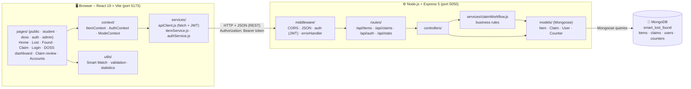
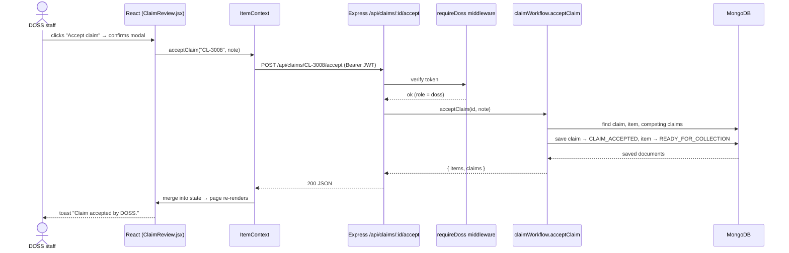

# Architecture

[← Back to README](../README.md) · [Database design](DATABASE.md) · [API details](API.md) · [Team roles](TEAM_ROLES.md)

Smart Lost & Found is a three-tier full-stack application:

```
React.js (frontend)  →  Node.js + Express.js (REST API)  →  MongoDB (database)
```

## Diagram



## Layers

| Layer | Folder | Responsibility |
|---|---|---|
| **Presentation** | `src/pages/<role>/`, `src/components/<feature>/`, `src/styles/` | What the user sees; forms with client-side validation for quick feedback |
| **State** | `src/context` | Shared items/claims (`ItemContext`), DOSS login (`AuthContext`), Student/DOSS view (`ModeContext`) |
| **API client** | `src/services` | The only code that calls the server. `apiClient.js` adds JSON headers and the JWT and turns error responses into `ApiError` |
| **Routing** | `server/src/routes` | Maps URLs + HTTP methods to controllers and applies `requireDoss` / `optionalAuth` |
| **Controllers** | `server/src/controllers` | Read the request, call models/services, send JSON |
| **Business rules** | `server/src/services/claimWorkflow.js` | Claim lifecycle: who can claim, accept/reject/collect/resolve, auto-rejecting competing claims |
| **Data** | `server/src/models` | Mongoose schemas = database design + server-side validation |
| **Database** | MongoDB | Persistent storage shared by every user |

## Request flow – "DOSS accepts a claim"



## Separation of concerns

- **Validation happens twice on purpose.** React validates for instant feedback; Mongoose validates again because a client can never be trusted. Server messages are shown under the matching form fields.
- **Privacy is enforced by the server.** `privateDetails` has `select: false` in the Item schema, so MongoDB never returns it unless a DOSS request asks for it. Claimants' personal data is removed from public claim responses (`PUBLIC_CLAIM_FIELDS`).
- **Clients cannot set protected fields.** Controllers copy only allowed fields (`pick()`), so a request cannot set `status` or `_id` itself.
- **One HTTP gateway.** Only `src/services/apiClient.js` calls `fetch`, so the API URL and error handling live in one place.

## Running the layers

| Command | Starts |
|---|---|
| `npm run dev` (root) | Express API on **5050** + React on **5173** (via `concurrently`) |
| `npm run dev:server` | API only |
| `npm run dev:client` | React only |

In development, Vite forwards every `/api/...` request to `http://localhost:5050` (see `vite.config.js`), so the browser only talks to one origin.
