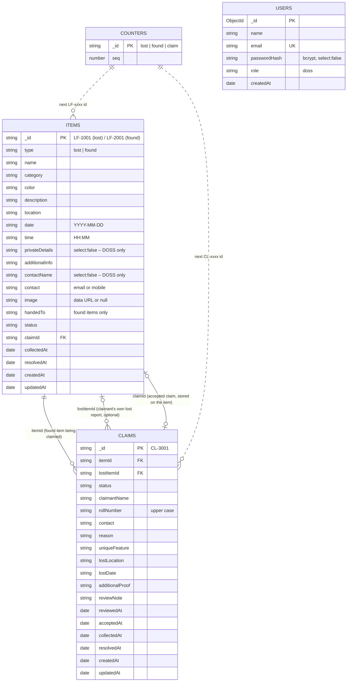

# Database design (MongoDB)

[← Back to README](../README.md) · [Architecture](ARCHITECTURE.md) · [API details](API.md) · [Team roles](TEAM_ROLES.md)

- **Database:** `smart_lost_found` (tests use `smart_lost_found_test`)
- **ODM:** Mongoose 9 – schemas in `backend/src/models/`
- **Connection:** `MONGODB_URI` in `backend/.env` (default `mongodb://127.0.0.1:27017/smart_lost_found`)

## Collections and relationships



## `items` – lost and found reports

| Field | Type | Rules (Mongoose) |
|---|---|---|
| `_id` | String | Readable ID from the counter: `LF-1xxx` lost, `LF-2xxx` found |
| `type` | String | required, `lost` \| `found` |
| `name` | String | required, 3–50 chars, letters/digits/punctuation regex |
| `category` | String | required, one of 10 categories |
| `color` | String | required, letters only, ≤ 30 |
| `description` | String | required, 10–400 chars (public) |
| `location` | String | required, one of 13 campus locations |
| `date` | String | required, `YYYY-MM-DD`, not in the future, within the last year |
| `time` | String | optional `HH:MM` |
| `privateDetails` | String | **`select: false`**; required (10+ chars) for lost reports, optional for found |
| `additionalInfo` | String | optional, ≤ 500 |
| `contactName` | String | **`select: false`** (DOSS only); required, letters only |
| `contact` | String | **`select: false`** (DOSS only); required, email **or** Indian mobile (custom validator) |
| `image` | String | `null` or a PNG/JPG/WEBP/GIF data URL (resized in the browser) |
| `handedTo` | String | found items: `Handed over to DOSS Office` \| `With the finder` |
| `status` | String | `LOST`, `FOUND`, `CLAIM_PENDING`, `READY_FOR_COLLECTION`, `COLLECTED`, `RESOLVED` – **set by the server only** |
| `claimId` | String → claims | the accepted claim |
| `collectedAt`, `resolvedAt` | Date | set by the workflow |
| `createdAt`, `updatedAt` | Date | automatic (`timestamps: true`) |

**Indexes:** `{ type: 1, status: 1 }` (list pages filter by type and status) and `{ createdAt: -1 }` (newest first).

## `claims` – ownership claims on found items

| Field | Type | Rules |
|---|---|---|
| `_id` | String | `CL-3xxx` |
| `itemId` | String → items | required, the found item (must be `FOUND` or `CLAIM_PENDING`) |
| `lostItemId` | String → items | optional link to the claimant's lost report (`LOST`) |
| `status` | String | `CLAIM_PENDING`, `CLAIM_ACCEPTED`, `CLAIM_REJECTED`, `COLLECTED`, `RESOLVED` |
| `claimantName` | String | required, letters only |
| `rollNumber` | String | required, stored in upper case, 6–12 letters/digits |
| `contact` | String | required, email or mobile |
| `reason` | String | required, 20–500 |
| `uniqueFeature` | String | required, 10–300 – compared with `privateDetails` by DOSS |
| `lostLocation`, `lostDate` | String | required; lost date not in the future and not after the found date |
| `additionalProof`, `reviewNote` | String | optional, ≤ 500 |
| `reviewedAt`, `acceptedAt`, `collectedAt`, `resolvedAt` | Date | set by the workflow |

**Indexes:** `{ status: 1, createdAt: -1 }` (DOSS queue), `{ itemId: 1 }` (claims of one item).

**Public view:** students only receive `PUBLIC_CLAIM_FIELDS` (ids, status, review note, dates) – never names, roll numbers, contacts or answers.

## `users` – students, DOSS staff and super admins

| Field | Type | Rules |
|---|---|---|
| `name` | String | required, letters only |
| `email` | String | unique index, lower case |
| `passwordHash` | String | bcrypt (10 rounds), `select: false` – the password itself is never stored |
| `role` | String | `student`, `doss` or `superadmin` |
| `rollNumber` | String | students only, normalised to upper case (`22-cse-045` → `22CSE045`) |
| `active` | Boolean | `false` = disabled by the super admin, cannot sign in |
| `lastLoginAt` | Date | set on every successful sign-in |

Student accounts are optional – guests can still report and claim.

## `counters` – readable sequential IDs

`{ _id: 'lost' | 'found' | 'claim', seq: Number }`. `nextId()` runs `findOneAndUpdate({ _id }, { $inc: { seq: 1 } }, { upsert: true })`, which is **atomic**: two simultaneous requests never get the same number.

## Why these design choices

- **Two collections linked by IDs (referencing) instead of embedding claims inside items:** an item can have several claims, claims are queried on their own (DOSS queue), and a claim can link two items (found + lost). `GET /api/claims/:id?populate=items` uses Mongoose `populate()` to join them.
- **Readable string IDs** (`LF-1001`, `CL-3001`) because students quote them at the DOSS counter.
- **Dates as `YYYY-MM-DD` strings** for `date`/`lostDate` – that is what an HTML date input sends and avoids time-zone shifts. Event times (`createdAt`, `acceptedAt` …) use real `Date` values.
- **Images inside the document** (≤ ~150 KB after browser compression) – far below MongoDB's 16 MB document limit, no extra file server needed.

## Seeding

```bash
npm run seed     # from the project root (or `npm run seed` inside backend/)
```

`backend/src/seed/seedDatabase.js` clears the collections and inserts 25 sample reports, 7 claims in different stages, the counters and one demo account per role (`student@college.edu` / `Student@123`, `doss@college.edu` / `Doss@123`, `admin@college.edu` / `Admin@123`). The API also seeds automatically when it starts with an empty database. **DOSS dashboard → Reset demo data** calls `POST /api/admin/reset`, which runs the same function.

## Useful mongosh commands for the demo

```js
use smart_lost_found
db.items.countDocuments()
db.items.find({ type: 'found', status: 'FOUND' }, { name: 1, location: 1 })
db.claims.find({ status: 'CLAIM_PENDING' })
db.items.aggregate([{ $group: { _id: '$category', count: { $sum: 1 } } }])
db.users.find({}, { email: 1, passwordHash: 1 })   // shows the bcrypt hash, not a password
```
