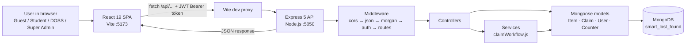
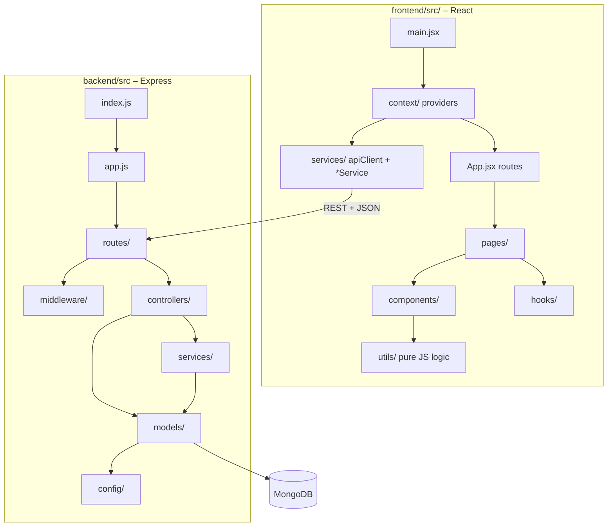
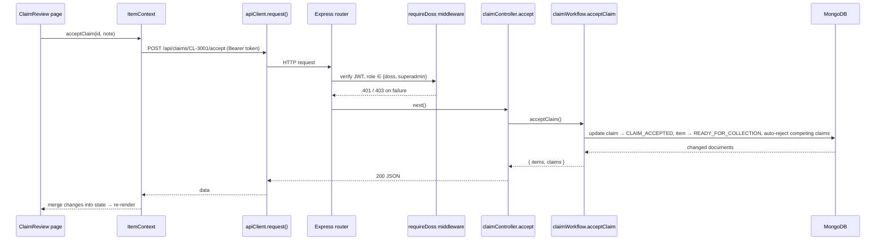
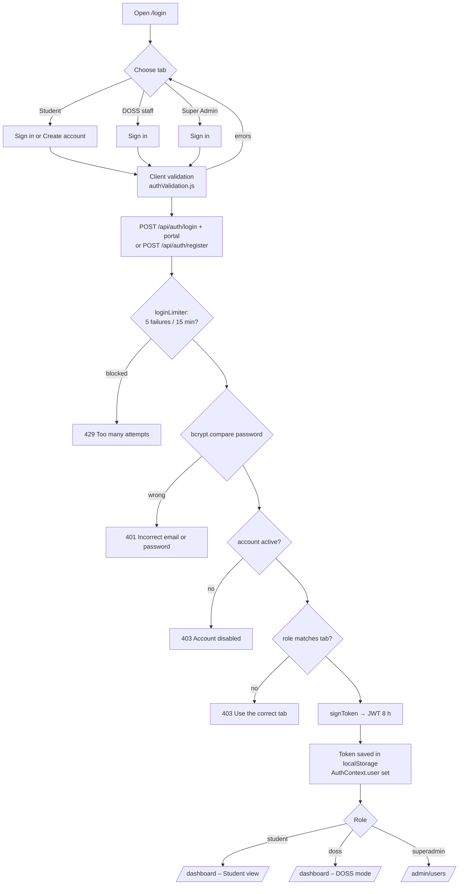
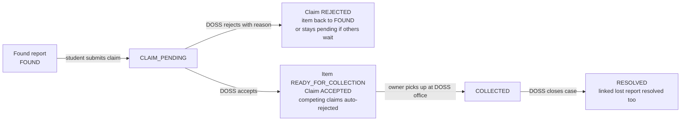
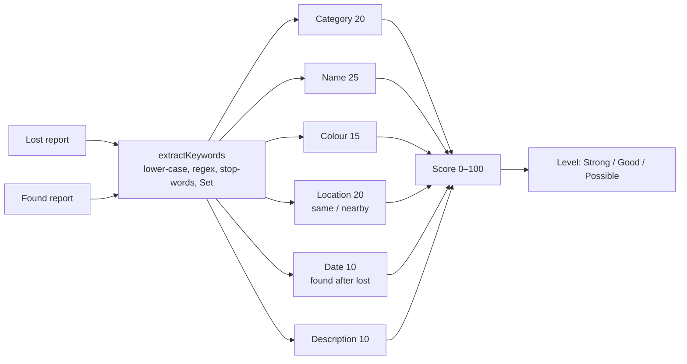
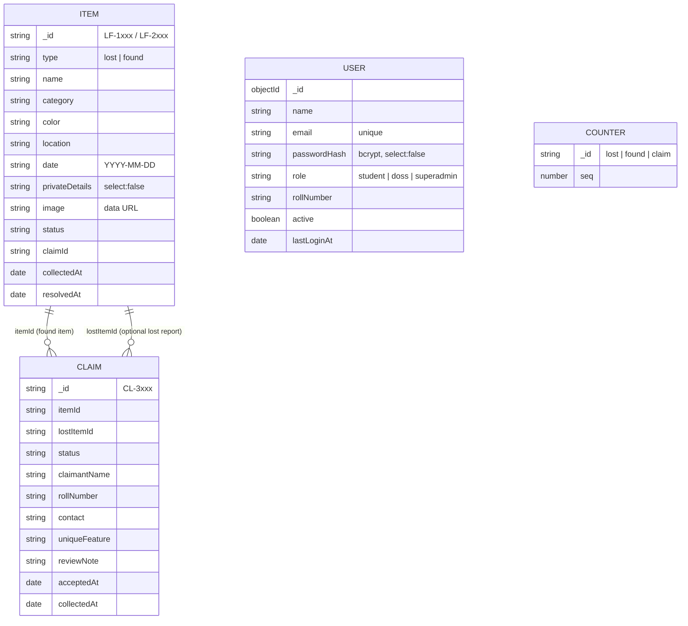

# Smart Lost & Found – Complete Project Prompt

> **How to use this file:** copy everything below the line into any AI assistant (or hand it to a teammate). It describes the whole project: every folder, every file, what each file contains, the flowcharts, the technology used for the frontend, backend and database, and every topic/concept used and *why* it was used.

---

## 0. Instruction

You are a senior full-stack engineer and a B.Tech CSE project guide. Below is the complete description of my 3rd-year Full Stack Development project **"Smart Lost & Found – College Campus Lost & Found Management System"**. Using **only** this information:

1. Explain the project end to end in simple, exam-ready language.
2. For every folder and file, explain what it contains, which topics/concepts it uses, and why those topics were chosen.
3. Redraw and explain the flowcharts (system architecture, request lifecycle, authentication, claim workflow).
4. Explain the frontend, backend and database technologies and how they talk to each other.
5. Prepare likely viva questions with short answers for each layer.

Do not invent features that are not listed here.

---

## 1. Project overview

| Item | Detail |
|---|---|
| Name | Smart Lost & Found – College Campus Lost & Found Management System |
| Type | Full-stack web application (MERN-style: MongoDB, Express, React, Node.js) |
| Repository | `github.com/madhusudhan1260/smart-lost-and-found` (private) |
| Problem | Students lose phones, ID cards, wallets, keys, etc. on campus. Found items pile up at the DOSS (Dean of Student Services) office with no easy way to match them with owners or verify who the real owner is. |
| Solution | Students report lost/found items online. A **Smart Match** algorithm scores lost vs found reports. Owners submit an **ownership claim** with proof (a unique feature only the owner knows). **DOSS staff** compare the claim with hidden **private details** and accept or reject it. The item is then collected and the case resolved. |
| Users / roles | **Guest** (no login), **Student** (optional account), **DOSS staff**, **Super Admin** |
| Core workflow | Report → Smart Match → Claim → DOSS review (accept / reject) → Ready for collection → Collected → Resolved |

### Roles and permissions

| Action | Guest | Student | DOSS staff | Super Admin |
|---|:-:|:-:|:-:|:-:|
| Browse lost/found items, Smart Match, statistics | ✅ | ✅ | ✅ | ✅ |
| Report a lost / found item | ✅ | ✅ | ✅ | ✅ |
| Submit an ownership claim | ✅ | ✅ (form pre-filled) | – | – |
| See private verification details | ❌ | ❌ | ✅ | ✅ |
| Accept / reject claims, mark collected / resolved, edit / delete reports | ❌ | ❌ | ✅ | ✅ |
| Reset demo data | ❌ | ❌ | ✅ | ✅ |
| Manage accounts (create, disable, change role, delete) | ❌ | ❌ | ❌ | ✅ |

Demo accounts (seed data only): Student `student@college.edu / Student@123`, DOSS `doss@college.edu / Doss@123`, Super Admin `admin@college.edu / Admin@123`.

### Status values

- **Item:** `LOST`, `FOUND`, `CLAIM_PENDING`, `READY_FOR_COLLECTION`, `COLLECTED`, `RESOLVED`
- **Claim:** `CLAIM_PENDING`, `CLAIM_ACCEPTED`, `CLAIM_REJECTED`, `COLLECTED`, `RESOLVED`
- **IDs:** lost reports `LF-1xxx`, found reports `LF-2xxx`, claims `CL-3xxx` (readable, sequential)

---

## 2. Technology stack (what and why)

### Frontend

| Technology | Version | Used for | Why |
|---|---|---|---|
| React | 19 | Component-based UI | Reusable components, state, hooks, fast re-rendering with the virtual DOM |
| React DOM | 19 | Renders React into the browser; `createPortal` for modals | Portals keep dialogs above every other element |
| React Router DOM | 7 | Client-side routing (`/lost`, `/items/:id`, `/login` …) | Single Page Application: no full page reloads, URL parameters, query strings |
| Vite | 8 | Dev server, hot module reload, production build | Very fast startup; dev **proxy** forwards `/api` to the backend (no CORS problems in development) |
| @vitejs/plugin-react | 6 | JSX + Fast Refresh | Needed by Vite for React |
| Context API | built in | Global state (auth, mode, items, notifications) | Avoids "prop drilling"; no extra library like Redux needed for this size |
| Fetch API | built in | HTTP calls to the REST API | Native, promise-based, no axios dependency |
| localStorage / sessionStorage | built in | JWT token, mode, drafts, filters, "my claims" IDs | Survives page reloads; per-browser settings |
| Plain CSS (custom properties) | – | Google-Material-inspired design system in `frontend/src/styles/` | Full control, no framework; tokens for colours, radius, shadows; media queries for mobile |
| material-symbols | 0.47 | Icons (bundled locally) | Works offline, consistent Google look |
| @fontsource/roboto | 5 | Roboto font (bundled locally) | No Google Fonts request, works offline |
| oxlint | 1.x | Linting | Very fast linter catching React/JS mistakes |

### Backend

| Technology | Version | Used for | Why |
|---|---|---|---|
| Node.js | ≥ 18 (ES modules) | JavaScript runtime for the server | Same language on frontend and backend; non-blocking I/O |
| Express | 5 | REST API, routing, middleware | Minimal, standard; v5 forwards errors from `async` handlers automatically |
| Mongoose | 9 | MongoDB object modelling | Schemas, validation, defaults, indexes, `populate()`, aggregation |
| jsonwebtoken | 9 | Creates and verifies JWT tokens (8 h expiry) | Stateless authentication – the server stores no sessions |
| bcryptjs | 3 | Password hashing (10 salt rounds) | Passwords are never stored in plain text |
| cors | 2 | Allows the React origin to call the API | Browser security (Same-Origin Policy) |
| dotenv | – | Reads `backend/.env` | Secrets and settings kept out of the code |
| morgan | 1 | Request logging (`GET /api/items 200 4 ms`) | Debugging and monitoring |
| supertest (dev) | 7 | HTTP integration tests | Calls the Express app in tests without starting a real server |
| node:test (built in) | – | Test runner for frontend utils and API | No Jest/Mocha dependency needed |
| concurrently (root dev) | 10 | `npm run dev` starts API + React together | One command for the whole stack |

### Database

| Technology | Used for | Why |
|---|---|---|
| MongoDB (local `mongodb://127.0.0.1:27017/smart_lost_found`, or Atlas) | Stores items, claims, users, counters | Document database – a report with optional photo and flexible fields fits a JSON document naturally; scales easily |
| Separate test database `smart_lost_found_test` | Automated API tests | Tests never touch real/demo data |

---

## 3. Flowcharts

### 3.1 System architecture



### 3.2 Folder / layer map



### 3.3 Request lifecycle (example: DOSS accepts a claim)



### 3.4 Authentication flow



### 3.5 Claim workflow (core business logic)



Rules enforced on the server: only `FOUND`/`CLAIM_PENDING` items can be claimed; the same person (roll number/contact) cannot claim the same item twice (409); a claim can be reviewed only once (409); rejection needs a reason (400); the lost date cannot be after the found date.

### 3.6 Smart Match algorithm



---

## 4. Folder structure

```
lost_and_found/
│
├── README.md                ← start here
├── package.json             ← "run everything" commands (npm run dev, npm test …)
│
├── frontend/                ← 1. WHAT THE USER SEES (React + Vite)
│   ├── index.html
│   ├── vite.config.js       ← dev server; sends /api calls to the backend
│   ├── public/              ← favicon, campus-tips.json
│   ├── tests/               ← unit tests for src/utils (npm run test:frontend)
│   └── src/                 ← see frontend/src/README.md for a guide
│       ├── main.jsx         ← starts React (router + providers)
│       ├── App.jsx          ← every URL → page
│       ├── pages/           ← one file per screen
│       │   ├── public/      Home  LostItems  FoundItems  ItemDetails  SmartMatch  ResolvedItems  NotFound
│       │   ├── student/     ReportLost  ReportFound  ClaimItem  MyClaims  StudentDashboard
│       │   ├── doss/        DossDashboard  DossClaims  ClaimReview
│       │   ├── auth/        Login
│       │   └── admin/       AdminUsers
│       ├── components/      ← reusable pieces used by the pages
│       │   ├── layout/      Navbar  Footer  AccountMenu  ModeSwitcher  ModeGate  PageHeader …
│       │   ├── ui/          Icon  Modal  StatCard  EmptyState  LoadingSpinner  FormField …
│       │   ├── items/       ItemCard  ItemsBrowser  ItemForm  SearchBar  FilterPanel …
│       │   ├── claims/      ClaimForm  ClaimCard  ClaimTimeline  ClaimReview …
│       │   └── matching/    MatchCard  MatchPairList
│       ├── context/         ← shared state: Auth, Mode, Item, Notification
│       ├── services/        ← talks to the backend: apiClient, authService, itemService, userService
│       ├── hooks/           ← custom hooks: useLocalStorage, useDebounce, useFormState …
│       ├── utils/           ← plain JS logic: matching, validation, statistics, dates …
│       ├── data/            ← constants (categories, locations, statuses, roles)
│       ├── styles/          ← CSS: tokens, base, controls, components, pages … (index.css imports them)
│       └── assets/          ← logo
│
├── backend/                 ← 2. SERVER + DATABASE (Node.js + Express + MongoDB)
│   ├── .env.example         ← copy to .env (PORT, MONGODB_URI, JWT_SECRET …)
│   ├── tests/               ← API integration tests (npm run test:backend)
│   └── src/
│       ├── index.js         ← connect to MongoDB → start the API on :5050
│       ├── app.js           ← Express app: CORS, JSON, routes, errors
│       ├── routes/          ← URLs: /api/items, /api/claims, /api/auth, /api/users
│       ├── middleware/      ← auth (JWT + roles), login limiter, error handler
│       ├── controllers/     ← what each URL does: item, claim, auth, user, stats, admin
│       ├── services/        ← claimWorkflow.js – the claim rules
│       ├── models/          ← DATABASE: MongoDB collections Item, Claim, User, Counter
│       ├── seed/            ← DATABASE: sample data + demo accounts
│       ├── config/          ← settings, database connection, allowed values
│       └── utils/           ← small helpers
│
└── docs/                    ← 3. DOCUMENTATION
    ├── PROJECT_PROMPT.md    ← everything about the project in one file
    ├── ARCHITECTURE.md  API.md  DATABASE.md  TEAM_ROLES.md  SCREENSHOTS.md
    ├── concepts/            ← JAVASCRIPT_CONCEPTS.md, REACT_CONCEPTS.md
    ├── team-notes/          ← CONTRIBUTION_NOTES.md, file.md, file.docx
    └── screenshots/
```

---

## 5. File-by-file explanation

Format: **File – what it contains · topics used · why**

### 5.1 Root and setup files

| File | Contains | Topics used | Why |
|---|---|---|---|
| `frontend/index.html` | `<div id="root">`, script `frontend/src/main.jsx`, meta tags | HTML5, SPA entry | Vite serves one page; React renders everything inside `#root` |
| `frontend/vite.config.js` | `@vitejs/plugin-react`, `server.proxy: { '/api': 'http://localhost:5050' }`, `open: true` | Build tooling, reverse proxy | Same-origin calls in development – no CORS issues, no hard-coded backend URL |
| `package.json` (root) | Only run scripts: `setup`, `dev` (concurrently backend + frontend), `seed`, `build`, `lint`, `test`, `test:frontend`, `test:backend` | npm scripts, `--prefix` | One command to install, seed, run and test the whole stack |
| `frontend/package.json`, `backend/package.json` | Each side's own dependencies and scripts | ES modules (`"type": "module"`) | Frontend and backend can be installed, run and deployed separately |
| `.gitignore` | Ignores `node_modules`, `dist`, `.env*` but keeps `.env.example` | Secret management | Never push secrets (JWT secret, DB URI) |
| `frontend/.oxlintrc.json` | Lint configuration | Static analysis | Catch bugs and bad React patterns early |
| `README.md` | Overview, features, setup, demo accounts, testing checklist, viva Q&A | Documentation | Required by FSD guidelines; helps evaluators run it |
| `docs/concepts/JAVASCRIPT_CONCEPTS.md`, `REACT_CONCEPTS.md` | Concept → file mapping | Documentation | Viva preparation |
| `frontend/public/data/campus-tips.json` | Array of campus tips | Static JSON | Demonstrates `fetch()` of a static file + `setInterval` rotation |

### 5.2 `docs/`

| File | Contains | Why |
|---|---|---|
| `ARCHITECTURE.md` | Layer diagram, request flow, folder responsibilities | Architecture diagram requirement |
| `DATABASE.md` | Collections, fields, validation rules, indexes, design choices, seeding | Database design requirement |
| `API.md` | Endpoint table, status codes, request/response examples, curl commands | API documentation requirement |
| `TEAM_ROLES.md` | Four roles: React frontend; Express/Node backend & APIs; MongoDB & database; Authentication, integration & testing | Team-role requirement |
| `SCREENSHOTS.md` + `screenshots/` | 16 screenshots (home, lists, details, report form, claim form, Smart Match, my claims, DOSS login, dashboard, claims, review, resolved, mobile, JSON) | Screenshot requirement |

---

### 5.3 Backend – `backend/`

#### Entry and app

| File | Contains | Topics | Why |
|---|---|---|---|
| `backend/package.json` | Express, Mongoose, jsonwebtoken, bcryptjs, cors, dotenv, morgan, supertest; scripts `start`, `dev` (`node --watch`), `seed`, `test` | Dependency management | Backend is an independent package |
| `backend/.env.example` | `PORT=5050`, `MONGODB_URI`, `JWT_SECRET`, `JWT_EXPIRES_IN=8h`, `CLIENT_ORIGIN`, demo account emails/passwords | Environment variables | Configuration without changing code; real `.env` is git-ignored |
| `backend/src/index.js` | Connects to MongoDB, seeds if the DB is empty, ensures demo accounts, `app.listen(5050)`; exits with a clear message if MongoDB is down | Top-level `await`, process lifecycle | Separates *starting* the server from *defining* it |
| `backend/src/app.js` | `express()`; middleware in order: `cors(clientOrigin)` → `express.json({ limit: '2mb' })` → `morgan` (not in tests) → `/api` routes → `notFound` → `errorHandler` | Middleware pipeline, CORS, body parsing | Exported separately so tests can import the app without opening a port |

#### `config/`

| File | Contains | Topics | Why |
|---|---|---|---|
| `env.js` | `config` object built from `process.env` with safe defaults (port, mongoUri, jwtSecret, jwtExpiresIn, clientOrigin, demo emails/passwords, isTest) | `dotenv`, default values with `||` | One source of settings |
| `db.js` | `connectDB`, `disconnectDB`, `isDatabaseConnected`; connection event logs | Mongoose connection | Used by server, seed script and tests |
| `constants.js` | `CATEGORIES`, `LOCATIONS`, `ITEM_TYPES`, `STATUS`, `ITEM_STATUSES`, `CLAIM_STATUSES`, `HANDED_TO`, `PATTERNS` (regex), `ROLES`, `STAFF_ROLES`, `PASSWORD_RULE` | Enums, regular expressions | Same allowed values validated on the server as on the client |

#### `models/` (Mongoose schemas = database design)

| File | Contains | Topics | Why |
|---|---|---|---|
| `Item.js` | Fields: `_id` (LF-xxxx), `type` (lost/found), `name`, `category`, `color`, `description`, `location`, `date`, `time`, `privateDetails` (**`select: false`**), `additionalInfo`, `contactName`, `contact`, `image` (base64 data URL), `handedTo`, `status`, `claimId`, `collectedAt`, `resolvedAt`, timestamps. Validators: required, enum, regex `match`, min/max length, custom "date not in future". Indexes `{type, status}`, `{createdAt: -1}`. `toJSON` maps `_id → id` | Schema, validation, indexes, projection, transforms | Data integrity in the database layer; private details hidden by default so they never leak to students |
| `Claim.js` | Fields: `_id` (CL-xxxx), `itemId` & `lostItemId` (**refs to Item**), `status`, `claimantName`, `rollNumber` (setter normalises `22-cse-045 → 22CSE045`), `contact` (email or Indian mobile custom validator), `reason`, `uniqueFeature`, `lostLocation`, `lostDate`, `additionalProof`, `reviewNote`, `reviewedAt`, `acceptedAt`, `collectedAt`, `resolvedAt`. Exports `PUBLIC_CLAIM_FIELDS`. Indexes `{status, createdAt}`, `{itemId}` | References (relationships), setters, custom validators | Referencing instead of embedding: one item can have many claims; DOSS queries claims by status |
| `User.js` | `name`, unique `email` (lower-case), `passwordHash` (**`select: false`**), `role` (`student`/`doss`/`superadmin`), `rollNumber` (students), `active`, `lastLoginAt`. Static `hashPassword()` (bcrypt), method `checkPassword()`; `toJSON` removes the hash | Statics vs methods, hashing, unique index | Secure authentication; role-based access |
| `Counter.js` | `{ _id: 'lost'|'found'|'claim', seq }`; `nextId(kind)` uses `findOneAndUpdate({$inc:{seq:1}}, {upsert:true, returnDocument:'after'})` | Atomic operations | Readable sequential IDs without duplicates even with simultaneous requests |

#### `controllers/` (request handlers)

| File | Contains | Topics | Why |
|---|---|---|---|
| `itemController.js` | `listItems` (filters `type/status/category/location/search`; values cast with `String()`; regex search escaped), `getItem`, `createItem` (whitelisted fields via `pick`, server sets id + status), `updateItem`, `deleteItem` (also deletes its claims), `collectItem`, `resolveItem`. Adds `+privateDetails` only for staff | CRUD, query filters, NoSQL-injection protection, regex escaping | Clients cannot set `status`/`_id`; `{ $ne: … }` objects in query strings are neutralised |
| `claimController.js` | `listClaims` (public sees only `PUBLIC_CLAIM_FIELDS`), `getClaim` (`?populate=items` for DOSS), `createClaim`, `accept`, `reject` | Projection, `populate()`, role-based data | Personal data (names, contacts, answers) only visible to staff |
| `authController.js` | `login` (portal/tab check, disabled check, `lastLoginAt`, same error for unknown email and wrong password), `register` (students only – role never taken from body; password rule), `me` | Authentication, enumeration-safe errors | Nobody can sign up as staff; attackers cannot discover which emails exist |
| `userController.js` | Super admin: `listUsers` (`?role=`), `createUser`, `updateUser` (active / role / password; cannot disable or demote self), `deleteUser` (not self) | Authorisation, business rules | Account management without lock-out |
| `statsController.js` | `GET /api/stats` with **aggregation pipeline** `$group` / `$sort` (items by type+status, claims by status, items by category) run in parallel with `Promise.all` | Aggregation (≈ SQL GROUP BY) | Counting is done inside MongoDB, efficient |
| `adminController.js` | `resetData` → re-runs the seed | – | "Reset demo data" button for demos |

#### `services/claimWorkflow.js`

`submitClaim`, `acceptClaim`, `rejectClaim`, `markCollected`, `markResolved`. Each validates the current status, updates the item and claim(s), auto-rejects competing claims on accept, resolves the linked lost report, and returns `{ items, claims }` (only the changed documents). **Topics:** service layer, business rules, state machine, HTTP 409 conflicts. **Why:** keeps controllers thin and puts the rules in one testable place on the server (never trust the client).

#### `routes/`

| File | Routes |
|---|---|
| `index.js` | `GET /health`, `POST /auth/login` (with `loginLimiter`), `POST /auth/register`, `GET /auth/me` (requireAuth), `/items`, `/claims`, `/users`, `GET /stats`, `POST /admin/reset` (requireDoss) |
| `itemRoutes.js` | `GET /` & `GET /:id` (optionalAuth), `POST /` (public), `PATCH /:id`, `DELETE /:id`, `POST /:id/collect`, `POST /:id/resolve` (requireDoss) |
| `claimRoutes.js` | `GET /`, `GET /:id` (optionalAuth), `POST /` (public), `POST /:id/accept`, `POST /:id/reject` (requireDoss) |
| `userRoutes.js` | `router.use(requireSuperAdmin)` then `GET /`, `POST /`, `PATCH /:id`, `DELETE /:id` |

**Topics:** Express Router, REST conventions (nouns + HTTP verbs), route-level middleware. **Why:** modular, readable URL design.

#### `middleware/`

| File | Contains | Topics | Why |
|---|---|---|---|
| `auth.js` | `signToken(user)` (payload `sub, role, name`), `readUser` (Bearer header, `jwt.verify`), `optionalAuth`, `requireRole(...roles)` (401 no token / 403 wrong role), `requireAuth`, `requireDoss` (doss + superadmin), `requireSuperAdmin`, `isDoss(req)` | JWT, higher-order functions (middleware factory), RBAC | Stateless, role-based access control |
| `errorHandler.js` | `notFound` (404), `errorHandler`: Mongoose `ValidationError → 400` with per-field `details`, duplicate key `11000 → 409` (special message for email), bad JSON `→ 400`, too large `→ 413`, `HttpError → its status`, else `500` | Centralised error handling | Every error becomes consistent JSON `{ error, details? }` the UI can show |
| `loginLimiter.js` | In-memory `Map` of `ip|email → { count, firstAt }`; 5 failures → 429 for 15 min; `recordFailure`, `clearFailures` | Rate limiting, brute-force protection | Slows password guessing |

#### `seed/`

| File | Contains | Why |
|---|---|---|
| `sampleItems.js` | 25 realistic campus reports (dates relative to today) | Demo always looks fresh |
| `sampleClaims.js` | 7 claims in every stage | Demonstrates the full workflow |
| `seedDatabase.js` | Clears collections, `insertMany` (keeps original timestamps), sets counters to the highest ID, `ensureDemoUsers()` (student, DOSS, super admin) | Repeatable demo data |
| `seed.js` | CLI script for `npm run seed` | One command reset |

#### `utils/`

| File | Contains | Why |
|---|---|---|
| `HttpError.js` | `class HttpError extends Error { status, details }` | Throw an HTTP status from anywhere (ES6 class inheritance) |
| `pick.js` | `pick(source, fields)` whitelist | Mass-assignment protection |
| `dates.js` | `toISODate`, `daysAgoISO`, `isoHoursAgo`, `daysBetween`, `isFutureDate` (local-date parsing) | Date rules without time-zone bugs |

#### `backend/tests/api.test.js`

25 integration tests with `node:test` + `supertest` against `smart_lost_found_test`: health, 404 JSON, wrong password 401, JWT never returns the hash, DOSS-only 401, role tabs (student on DOSS tab → 403, admin on DOSS tab OK), student sign-up can't become staff, duplicate email 409, weak password 400, student token can't accept claims (403) or see private details, super admin manages users and disabled accounts can't log in, admin can't lock themselves out, public list hides private details, search, validation 400 with `details`, server ignores client `status`, update/delete need DOSS, full claim workflow, duplicate claim 409, public claims hide personal data, reject needs reason, accept → collect → resolve, resolved item can't be claimed, competing claims auto-rejected, `populate`, aggregation stats, admin reset. **Why:** proves the backend rules work and protects against regressions.

---

### 5.4 Frontend – `frontend/src/`

#### Entry

| File | Contains | Topics | Why |
|---|---|---|---|
| `main.jsx` | `createRoot`, `<StrictMode>`, `<BrowserRouter>`, providers nested `Notification → Auth → Mode → Item`, imports fonts/icons/CSS | Provider pattern, React 19 root | Every page can use shared state; order matters (Mode needs Auth, Item needs Auth) |
| `App.jsx` | Routes (every page except Home is loaded on demand with `React.lazy` + `Suspense`); `/login` rendered full-screen without navbar; offline banner (`useOnlineStatus`), server-error banner with "Try again", skip link, `key={location.pathname}` page animation, Navbar/Footer/BackToTop/KeyboardShortcuts, `useRipple` | React Router `<Routes>/<Route>`, dynamic params, conditional rendering, accessibility | Central navigation map of the SPA |
| `index.css` | `index.css` only imports the 10 files in `styles/` in order. They hold: design tokens (`--blue`, `--radius`, shadows), base, buttons/chips/badges/forms, layout components, pages, login page (split layout, tabs, strength meter, shake animation), account menu, admin page, animations (`fadeUp`, `spin`), responsive media queries (1180/900/640/480px), `prefers-reduced-motion` | CSS custom properties, Grid, Flexbox, media queries, keyframes | Consistent Google-Material look; works on phones; respects accessibility settings |

#### Routes (pages)

| Route | Page | Access |
|---|---|---|
| `/` | Home | All |
| `/lost`, `/found` | LostItems, FoundItems | All |
| `/items/:id` | ItemDetails | All |
| `/smart-match`, `/smart-match/:id` | SmartMatch | All |
| `/resolved` | ResolvedItems | All |
| `/dashboard` | StudentDashboard or DossDashboard (by mode) | All |
| `/report-lost`, `/report-found` | ReportLost, ReportFound | Student mode |
| `/items/:id/claim` | ClaimItem | Student mode |
| `/my-claims` | MyClaims | Student mode |
| `/doss/claims`, `/doss/claims/:claimId` | DossClaims, ClaimReview | DOSS mode |
| `/login` | Login | All |
| `/admin/users` | AdminUsers | Super Admin |
| `*` | NotFound | All |

#### `context/` (global state)

| File | Contains | Topics | Why |
|---|---|---|---|
| `AuthContext.jsx` | Token in `useLocalStorage`, `user`, `checking`; on load verifies token with `GET /auth/me` (expired → removed, with cleanup flag); `login(email, password, portal)`, `register(fields)`, `logout`; derived `isStaff`, `isSuperAdmin`, `isStudentAccount`; `useMemo` value; `useAuth()` guard | Context API, `useEffect` with cleanup, `useCallback`, `useMemo`, custom hook | One source of truth for who is logged in |
| `ModeContext.jsx` | Student/DOSS mode in localStorage; `switchMode` (DOSS without staff login → navigates to `/login?role=doss&next=…`), `enterMode`, `isDoss = mode === DOSS && isStaff`; auto-returns to Student after logout | Derived state, `useNavigate`, `useLocation` | Two interfaces in one app; DOSS view can't be faked without a staff token |
| `ItemContext.jsx` | `items`, `claims`, `loading`, `error`; `loadData` with `Promise.all` (reloads after login/logout); `applyChanges` merges server `{items, claims}`; addItem, updateItem, deleteItem, submitClaim, acceptClaim, rejectClaim, markCollected, markResolved, resetData; `myClaimIds` + `trackClaim` | Async/await, immutable updates, `useCallback` | All data operations in one place; UI updates instantly from server responses |
| `NotificationContext.jsx` | `notify(message, type, duration)` + toast queue rendered by `Notification` | Context, timers | Feedback after every action |

#### `services/` (API layer)

| File | Contains | Topics | Why |
|---|---|---|---|
| `apiClient.js` | `request(path, { method, body })`: fires a session-expired event on 401 with a saved token; base URL `VITE_API_URL` or `/api`, JSON headers, adds `Authorization: Bearer <token>`, `ApiError(message, status, details)`, network failure / 502+ without JSON → "Cannot reach the server…" | Fetch API, custom Error class, promises | One place for HTTP; friendly errors |
| `authService.js` | `login`, `register`, `getCurrentUser` | REST calls | Separates API from UI |
| `itemService.js` | `getItems`, `getItem`, `addItem`, `updateItem`, `deleteItem`, `markCollected`, `markResolved`, `getClaims`, `addClaim`, `acceptClaim`, `rejectClaim`, `getStats`, `resetAllData`, `getCampusTips` | CRUD over REST | Same |
| `userService.js` | `getUsers`, `createUser`, `updateUser`, `deleteUser` | REST | Super admin page |

#### `pages/` (grouped by role: `public/`, `student/`, `doss/`, `auth/`, `admin/`)

| File (in `frontend/src/pages/`) | Contains | Topics | Why |
|---|---|---|---|
| `public/Home.jsx` | Hero search, animated stats, category tiles, recent items, top Smart Match pairs, recent claims, campus tips | Composition, `useMemo`, navigation with query strings | Landing page that shows the system at a glance |
| `public/LostItems.jsx` / `public/FoundItems.jsx` | Wrap `ItemsBrowser` for each type | Reusability via props | Same browser, two lists |
| `public/ItemDetails.jsx` | Full report, photo lightbox, status, best matches, claim button, DOSS actions (edit / delete / collect / resolve) with confirmation modals, breadcrumbs, recently viewed | `useParams`, conditional rendering by role | One detailed view per report |
| `student/ReportLost.jsx` / `student/ReportFound.jsx` | `ReportLayout` + `ItemForm` | Controlled forms | Data entry |
| `student/ClaimItem.jsx` | Item summary + `ClaimForm`; blocked if item not claimable | Guard logic | Proof-of-ownership flow |
| `student/MyClaims.jsx` | Claims submitted from this browser with `ClaimTimeline`, look up by claim ID | localStorage, timelines | Students follow their claim |
| `public/SmartMatch.jsx` | Choose a lost report → ranked found matches with score ring and factor breakdown; threshold slider | Algorithm visualisation, `range` input | Shows the matching logic |
| `student/StudentDashboard.jsx` | My claims, possible matches, campus stats, activity | `reduce`-based stats | Personal overview |
| `doss/DossDashboard.jsx` | Stat cards, pending claims queue, ready-for-collection list, category bar chart, 7-day trend, recent activity, Reset demo data | Data visualisation without libraries | DOSS overview |
| `doss/DossClaims.jsx` | Claims grouped in status tabs, search by name/roll/contact/ID | Filtering, tabs | Work queue |
| `doss/ClaimReview.jsx` | Side-by-side claim vs private details, verification score, accept (note) / reject (reason) / collect / resolve | Business UI, modals | DOSS decision screen |
| `public/ResolvedItems.jsx` | History table, filter, avg days to return, return rate % | `filter/reduce/sort`, responsive table | Outcome reporting |
| `auth/Login.jsx` | Split layout (brand panel with live stats + card). Tabs Student / DOSS staff / Super Admin (ARIA tabs, arrow-key navigation, URL `?role=` synced). Email + password with icons, show/hide, Caps Lock warning, inline field errors, error alert with shake, loading state, "Use demo" per tab. Student **sign-up** (name, roll, email, password + strength meter, confirm). "Continue as guest". Already-signed-in view. Safe `next` redirect (only internal paths). Redirects by role | Controlled forms, `useSearchParams`, accessibility, open-redirect protection | Professional single sign-in for all roles |
| `admin/AdminUsers.jsx` | Super-admin guard; stat cards per role; filter + search; accounts table (avatar initials, role dropdown, active badge, last sign-in "time ago", enable/disable, delete with confirm modal); "Add an account" form with password generator | CRUD UI, optimistic list updates | Account management |
| `public/NotFound.jsx` | 404 with suggestions | Catch-all route | Friendly unknown URLs |

#### `components/` (reusable UI, grouped by feature)

| Folder (in `frontend/src/components/`) | File | Contains / topics |
|---|---|---|
| `layout/` – around every page | `Navbar.jsx` | Links per mode (data-driven arrays), pending-claims badge, mobile hamburger (Escape closes), scroll shadow, DOSS banner with sign-out, **Accounts** link for super admin |
| | `AccountMenu.jsx` | Guest "Sign in" (keeps `next`); avatar dropdown (name, email, role badge, Manage accounts / My claims, Sign out); keyboard support (arrows, Home/End, Escape returns focus); closes on outside click (`useRef`, document listeners) |
| | `ModeSwitcher.jsx` | Student/DOSS toggle as ARIA radiogroup |
| | `ModeGate.jsx` | Shows a page only in the right mode, otherwise offers a switch |
| | `Footer.jsx` | DOSS office hours/location, quick links |
| | `PageHeader.jsx`, `Breadcrumbs.jsx`, `ReportLayout.jsx` | Page title area, "Home › Found › item" trail, report form layout with tips |
| | `ScrollToTop.jsx`, `BackToTop.jsx`, `KeyboardShortcuts.jsx` | Scroll reset on route change, floating top button, global shortcuts (`h l f m d`, `/`, `?` help dialog) |
| `ui/` – small building blocks | `Icon.jsx` | Material Symbols wrapper |
| | `Modal.jsx`, `Lightbox.jsx` | Confirmation dialog via `createPortal` with focus management; full-screen photo viewer |
| | `Notification.jsx` | Toasts with timer bar |
| | `EmptyState.jsx`, `LoadingSpinner.jsx` (`SkeletonGrid`, `DashboardSkeleton`) | Empty / error / loading states |
| | `StatusBadge.jsx` (`TypeChip`) | Colour-coded status pill |
| | `StatCard.jsx`, `DashboardCard.jsx`, `BarChart.jsx`, `ScoreRing.jsx` | Count-up number (`requestAnimationFrame`), panel card, pure-CSS bar chart, SVG score circle |
| | `Highlight.jsx` | Wraps searched words in `<mark>` (escaped regex) |
| | `TipTicker.jsx` | Fetches `campus-tips.json`, rotates with `setInterval` (cleared on unmount) |
| | `FormField.jsx` | Label + input + hint + error with `aria-describedby` |
| `items/` – lost & found reports | `ItemsBrowser.jsx` | Search + filters + grid/list toggle + results; filters saved per page; debounced search |
| | `SearchBar.jsx`, `FilterPanel.jsx`, `ActiveFilters.jsx` | "/" to focus search, dropdown filters, removable filter chips |
| | `ItemCard.jsx`, `ItemImage.jsx` | Report card; photo or category-icon fallback |
| | `ItemForm.jsx` | Lost/found form with validation, photo upload, **auto-saved draft** |
| | `ImageUploader.jsx` | Drag & drop, type/size validation, compression preview (FileReader + canvas) |
| `claims/` – ownership claims | `ClaimForm.jsx` | Proof-of-ownership form, link to own lost report (best match first), **pre-filled for signed-in students** |
| | `ClaimCard.jsx`, `ClaimTimeline.jsx` | Claim display; Submitted → Accepted → Collected → Resolved tracker |
| | `ClaimReview.jsx`, `CollectionInstructions.jsx` | Side-by-side verification panel for DOSS; pickup steps for the student |
| `matching/` – Smart Match | `MatchCard.jsx`, `MatchPairList.jsx` | One scored match with its factors; list of lost ↔ best found pairs |

**Why components:** single responsibility, reuse across pages, props for configuration, children for composition.

#### `styles/` (CSS, imported in order by `index.css`)

| File | Contains |
|---|---|
| `tokens.css` | Design tokens: Google colours, radius, shadows, font (`:root` custom properties) |
| `base.css` | Element defaults, layout helpers, accessibility helpers, icon sizes |
| `controls.css` | Buttons, chips, badges, inputs, error and hint text |
| `components.css` | Navbar, cards, modal, toasts, tabs, segmented buttons, charts |
| `pages.css` | Home hero, details, claim page, claim review, Smart Match, dashboards, tables |
| `animations.css` | `fadeUp`, `spin` and other keyframes |
| `responsive.css` | Tablet and phone breakpoints (1180 / 900 / 640 px) |
| `enhancements.css` | Ripple, filter chips, lightbox, print styles, tables as cards on phones |
| `auth.css` | Sign-in page: split layout, role tabs, password strength meter |
| `admin.css` | Account menu and super admin page |

**Why split:** each file has one job, so a change (e.g. colours → `tokens.css`) is easy to find; the import order keeps the cascade the same.

#### `hooks/` (custom hooks)

| Hook | Does | Why |
|---|---|---|
| `useLocalStorage` | `useState` mirrored to local/sessionStorage (safe JSON parse) | Persist token, mode, filters, drafts |
| `useDebounce` | Delays a value until typing stops | Avoids filtering on every keystroke |
| `useFormState` | Values, touched, errors, `fieldProps`, focus first error | Shared form logic for ItemForm/ClaimForm |
| `useDocumentTitle` | Sets tab title; pending-claims count in DOSS mode | UX |
| `useOnlineStatus` | `online`/`offline` events | Offline banner |
| `useRipple` | Material ripple via one document listener (event delegation) | Visual feedback with good performance |

#### `utils/` (pure JavaScript, no React – unit-tested)

| File | Exports | Topics | Why |
|---|---|---|---|
| `matching.js` | `MATCH_WEIGHTS`, `extractKeywords`, `getCommonKeywords`, `keywordSimilarity`, `getMatchBreakdown`, `calculateMatchScore`, `isOpenForMatching`, `findMatches`, `getMatchLevel` | Strings, regex, `Set`, arrays, weighted scoring | Smart Match without AI/ML – explainable |
| `claimUtils.js` | `canBeClaimed`, `statusAfterRejection`, `wasAccepted`, `verifyClaim` (score from private details, location, date, linked report), `getClaimTimeline` | Business rules, `reduce` | Helps DOSS decide; drives the tracker |
| `searchUtils.js` | `DEFAULT_FILTERS`, `SEARCHABLE_FIELDS` (public fields only), `createItemFilter` (closure / higher-order function), `sortItems` (sorter map), `applyFilters`, `hasActiveFilters`, `searchClaims` | Closures, HOFs, `every/some`, copy-before-sort | Fast client-side search; private details never searchable |
| `statistics.js` | `getItemStats`, `getClaimStats`, `getDossStats`, `countBy`, `toSortedEntries`, `getRecentItems`, `getPercentage`, `getDailyCounts`, `getTopMatchPairs`, `getRecentActivity` | `reduce`, `map`, `flatMap`, spread | Dashboard numbers and charts |
| `validation.js` | `PATTERNS`, `validateField`, `validateItemForm`, `validateClaimField`, `validateClaimForm`, `isFormValid`, `validateImageFile` | Regex, switch, date rules | Instant feedback; mirrors server rules |
| `authValidation.js` | `PASSWORD_RULE`, `getPasswordStrength` (0–4), `validateLogin`, `validateAccount` | Regex lookaheads | Login/sign-up/add-staff forms |
| `dateUtils.js` | `toISODate`, `parseLocalDate`, `daysBetween`, `isFutureDate`, `formatDate`, `formatDateTime`, `timeAgo`, `isInDateRange`, … | `Date`, `Intl` (`en-IN`) | Consistent dates, no time-zone shifts |
| `helpers.js` | `generateId`, `cx` (class names), `pluralize`, `getItemIcon`, `replaceById`, `mergeUpdates`, `truncate`, `copyToClipboard` | Utility functions, Clipboard API | Small reusable helpers |
| `imageUtils.js` | `readFileAsDataURL` (FileReader → Promise), `compressImage` (canvas, max size) | Promises, Canvas API | Photos ≤ ~150 KB stored in MongoDB |
| `storage.js` | `readFromStorage`, `writeToStorage`, `removeFromStorage` with try/catch | Error handling | Private mode / full storage never crashes the app |

#### `data/constants.js`

Categories, locations, nearby-locations map (for matching), `MODES`, `ROLES`, `STAFF_ROLES`, `ROLE_META` (label/icon/colour), `DEMO_ACCOUNTS`, `STATUS`, `STATUS_META`, status options per list, `STORAGE_KEYS`, DOSS office details, demo claim IDs. **Why:** no "magic strings" spread around the code.

#### `frontend/tests/` (frontend unit tests – 53 tests)

`authValidation.test.js`, `claimUtils.test.js`, `dateUtils.test.js`, `matching.test.js`, `searchUtils.test.js`, `statistics.test.js`, `validation.test.js` – run with `npm test` (`node --test`). **Why:** pure functions are easy to test and are the core logic of the app.

---

## 6. Database design



Design choices: **referencing** claims to items (one item → many claims, claims queried alone, `populate()` joins them); **readable string IDs** quoted at the DOSS counter; dates as `YYYY-MM-DD` strings (matches HTML date inputs, no time-zone shift); images inside the document (small after compression, far below the 16 MB limit); indexes on the most common queries; `select: false` for secrets.

---

## 7. REST API summary

| Method | Path | Access | Purpose |
|---|---|---|---|
| GET | `/api/health` | Public | API + DB status |
| POST | `/api/auth/login` | Public | Sign in (with `portal`) → JWT |
| POST | `/api/auth/register` | Public | Student sign-up → JWT |
| GET | `/api/auth/me` | Any account | Current user |
| GET | `/api/items` | Public* | List with filters/search |
| GET | `/api/items/:id` | Public* | One report |
| POST | `/api/items` | Public | Create report |
| PATCH | `/api/items/:id` | DOSS | Update |
| DELETE | `/api/items/:id` | DOSS | Delete (+ its claims) |
| POST | `/api/items/:id/collect` · `/resolve` | DOSS | Workflow steps |
| GET | `/api/claims` · `/api/claims/:id` | Public* | Claims (`?status=`, `?populate=items`) |
| POST | `/api/claims` | Public | Submit claim |
| POST | `/api/claims/:id/accept` · `/reject` | DOSS | Review |
| GET | `/api/stats` | Public | Aggregated counts |
| POST | `/api/admin/reset` | DOSS | Restore demo data |
| GET/POST/PATCH/DELETE | `/api/users[/:id]` | Super Admin | Account management |

\*Public\* = staff receive extra private fields. Status codes: 200/201, 400 (validation with `details`), 401, 403, 404, 409 (business conflict), 413, 429, 500.

---

## 8. Topics used – where and why (master list)

### JavaScript (ES6+)
| Topic | Where | Why |
|---|---|---|
| `let/const`, arrow functions, template literals | Everywhere | Modern, readable code |
| Destructuring, spread/rest | Components props, `applyChanges`, `pick` | Clean data handling, immutable updates |
| Array methods `map/filter/reduce/some/every/find/flatMap/sort` | `statistics.js`, `searchUtils.js`, pages | Declarative data processing |
| `Set`, `Map` | `extractKeywords` (unique words), `loginLimiter` (attempt store) | Uniqueness, fast key lookup |
| Closures & higher-order functions | `createItemFilter`, `requireRole(...roles)`, `bind()` in Login | Reusable configurable functions |
| Promises, `async/await`, `Promise.all` | Services, contexts, controllers | Non-blocking I/O, parallel requests |
| Classes & inheritance | `HttpError extends Error`, `ApiError` | Errors carrying HTTP status |
| Regular expressions | `validation.js`, `constants.js`, `PASSWORD_RULE` lookaheads, search escaping | Input validation and text processing |
| ES modules `import/export` | All files (`"type": "module"`) | Modular code on client and server |
| Optional chaining `?.`, nullish `??` | Everywhere | Safe access to missing data |
| `Date`, `Intl` | `dateUtils.js`, `dates.js` | Date maths and Indian date formats |
| Web APIs: Fetch, Storage, FileReader, Canvas, Clipboard, `online/offline`, `requestAnimationFrame`, `setInterval` | services, hooks, utils, components | Browser features without libraries |
| `try/catch/finally` | Services, forms, storage | Graceful error handling |

### React
| Topic | Where | Why |
|---|---|---|
| Functional components + JSX | All components/pages | Modern React |
| Props & children | `PageHeader`, `EmptyState`, `FormField`, `Modal` | Reuse and composition |
| `useState` | Forms, toggles, lists | Local state |
| `useEffect` (+ cleanup) | Token check, listeners, intervals, fetch | Side effects without leaks |
| `useMemo`, `useCallback` | Contexts, filtered lists, stats | Avoid unnecessary recalculation/re-renders |
| `useRef` | Modal focus, AccountMenu outside-click | DOM access without re-render |
| Context API + Provider pattern | 4 contexts | Global state without prop drilling |
| Custom hooks | 6 hooks + `useAuth/useMode/useItems/useNotification` | Reusable stateful logic |
| Controlled forms | ItemForm, ClaimForm, Login, AdminUsers | Single source of truth for inputs, live validation |
| Conditional & list rendering with `key` | Navbar links, tables, cards | Dynamic UI |
| React Router (`Routes`, `Route`, `Link`, `NavLink`, `useParams`, `useNavigate`, `useLocation`, `useSearchParams`) | App, pages | SPA navigation, URL state |
| Portals (`createPortal`) | Modal | Overlay above all content |
| Code splitting (`React.lazy`, `Suspense`) | App.jsx | Smaller first download (main bundle 417 kB → 252 kB) |
| `key` to reset a component | ClaimItem → ClaimForm | Re-create the form once the login is known |
| `StrictMode` | main.jsx | Detects unsafe patterns in development |
| Lifting state up | Filters → ItemsBrowser | Share state between siblings |

### Node.js / Express
| Topic | Where | Why |
|---|---|---|
| REST API design | routes/ | Standard client–server contract |
| Middleware pipeline | app.js, auth.js, errorHandler.js, loginLimiter.js | Cross-cutting concerns in order |
| Router modules | routes/*.js | Modular endpoints |
| MVC-style layering (routes → controllers → services → models) | backend/src | Separation of concerns, testability |
| Centralised error handling | errorHandler.js | Consistent JSON errors |
| Environment configuration | env.js, .env | Secrets out of code |
| CORS | app.js | Allow React origin |
| Logging | morgan | Debugging |

### MongoDB / Mongoose
| Topic | Where | Why |
|---|---|---|
| Schemas, types, required, enum, `match`, min/max, custom validators, setters | models/ | Data integrity |
| `timestamps`, `toJSON` transform | models/ | Automatic createdAt/updatedAt, clean API output |
| Indexes (compound, unique) | Item, Claim, User | Fast queries, unique emails |
| CRUD (`find`, `findById`, `create`, `insertMany`, `findByIdAndDelete`, `save`) | controllers, seed | Data operations |
| Projection (`select: false`, `.select('+field')`) | Item.privateDetails, User.passwordHash, PUBLIC_CLAIM_FIELDS | Data privacy |
| References + `populate()` | Claim → Item | Relationships |
| Aggregation pipeline (`$group`, `$sort`) | statsController | Server-side analytics |
| Atomic `$inc` with upsert | Counter.nextId | Safe sequential IDs |

### Security
| Topic | Where | Why |
|---|---|---|
| Password hashing (bcrypt) | User model | Plain passwords never stored |
| JWT stateless auth (8 h expiry) | auth.js, AuthContext | Scalable sessions |
| Role-based access control (student/doss/superadmin) | requireRole, ModeContext, AdminUsers | Least privilege |
| Login rate limiting | loginLimiter.js | Brute-force protection |
| Same message for unknown email / wrong password | authController | Prevents account enumeration |
| Role never taken from sign-up body | register | No privilege escalation |
| NoSQL-injection protection (`String()` casting) & regex escaping | itemController | Safe queries |
| Field whitelisting (`pick`) | controllers, workflow | No mass assignment |
| Private-field hiding | models/controllers | Privacy of verification details and personal data |
| Safe redirect (`next` must start with `/`, not `//`) | Login.jsx | Open-redirect protection |
| Body size limit (2 MB) | app.js | Abuse protection |
| Secrets in `.env`, git-ignored | backend | No leaked credentials |

### UI/UX, accessibility, performance
| Topic | Where | Why |
|---|---|---|
| Responsive design (Grid/Flex, breakpoints) | `styles/responsive.css` | Works on phones |
| ARIA roles (tabs, radiogroup, menu, alert, live regions), skip link, focus rings, keyboard navigation | Login, ModeSwitcher, AccountMenu, Modal, FormField | Accessibility |
| Skeleton loaders, empty states, toasts, error/offline banners | components | Clear feedback |
| Debouncing, event delegation, memoisation, image compression | hooks/utils | Performance |
| `prefers-reduced-motion` | `styles/animations.css`, `styles/enhancements.css` | Respects user settings |

### Testing & tooling
| Topic | Where | Why |
|---|---|---|
| Unit tests (`node:test`, `assert`) | `frontend/tests/` – 53 tests | Verify pure logic |
| Integration tests (`supertest`, separate DB) | `backend/tests/` – 25 tests | Verify API + DB + auth together |
| Linting (oxlint) | `npm run lint` | Code quality |
| Vite proxy, HMR, production build | vite.config.js | Fast development, optimised output |
| concurrently, `node --watch` | package.json | One-command full-stack dev with auto-restart |
| Git + GitHub (team of 4) | repo | Version control and collaboration |

---

## 9. How to run

```bash
npm run setup        # install root, frontend and backend packages and seed MongoDB
npm run dev          # API on http://localhost:5050, React on http://localhost:5173
npm test             # all tests: 53 frontend + 25 backend (MongoDB must be running)
npm run build        # production build into frontend/dist/
```

Sign in at `http://localhost:5173/login` with the demo accounts listed in section 1.

---

## 10. Expected output from you

1. A clear project explanation (abstract, problem, objectives, modules, conclusion).
2. A folder-by-folder and file-by-file explanation using sections 4–5.
3. The flowcharts from section 3, explained step by step.
4. Frontend vs backend vs database responsibilities and how data flows between them.
5. A table of every topic (section 8) with "where used" and "why used".
6. 40+ viva questions with short answers (React, Node/Express, MongoDB, security, testing, the Smart Match algorithm, the claim workflow, roles and login).
