# Application screenshots

[← Back to README](../README.md) · [Architecture](ARCHITECTURE.md) · [Database design](DATABASE.md) · [API details](API.md) · [Team roles](TEAM_ROLES.md)

All screenshots were taken from the running full-stack app (React → Express → MongoDB) with the sample data from `npm run seed`.

## Student

### Home
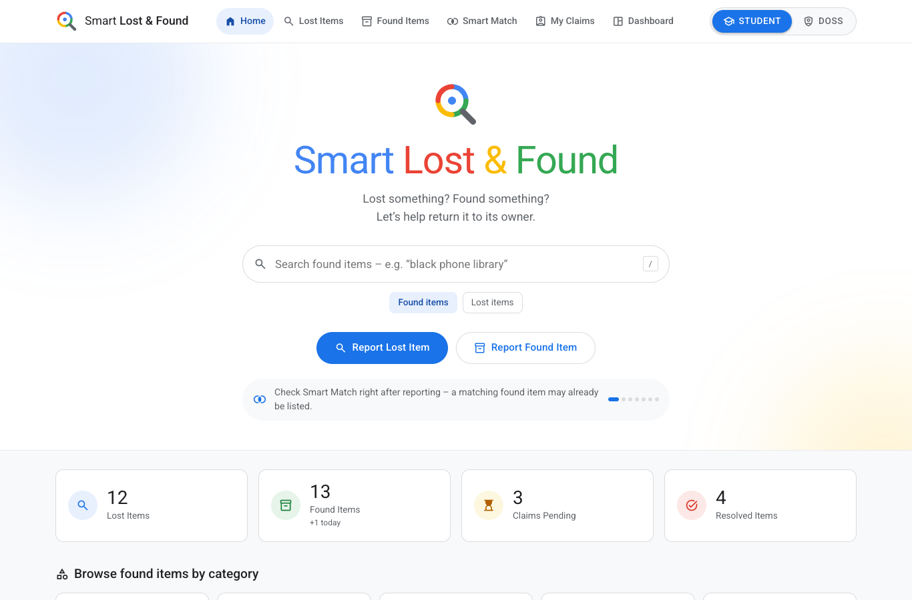

### Found items – search, filters, cards
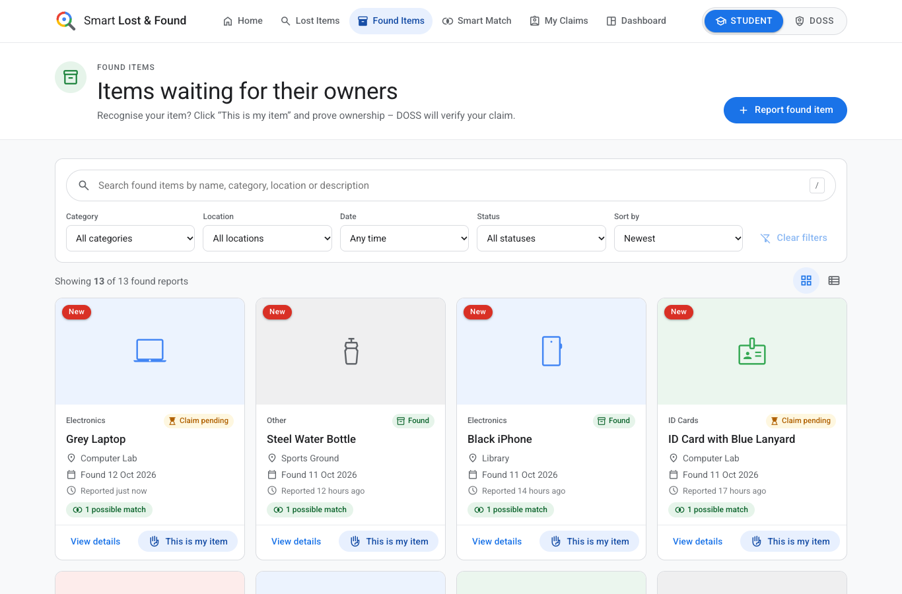

### Item details
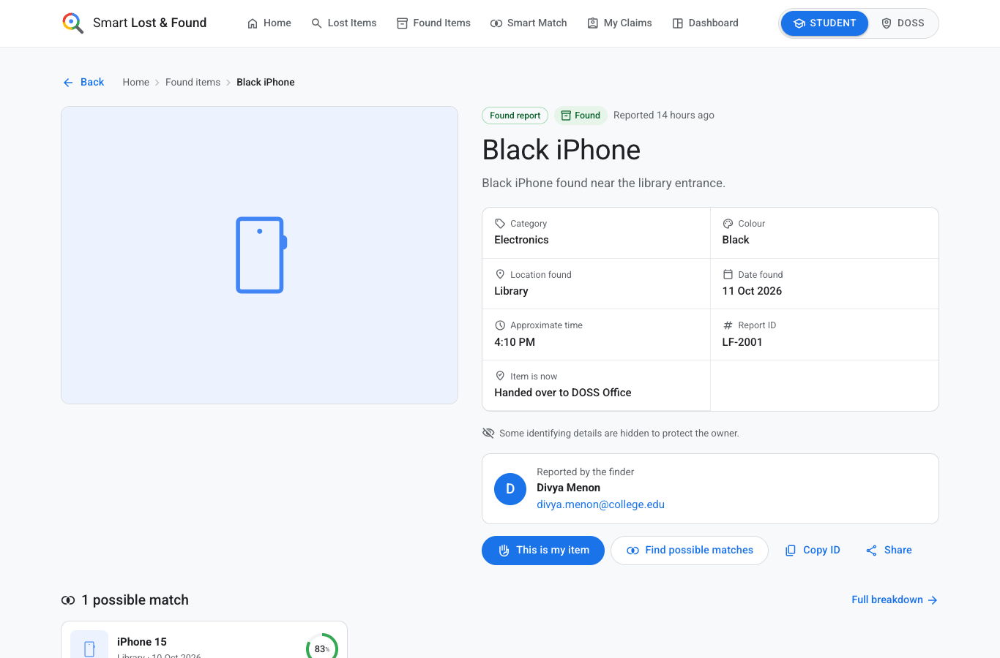

### Report a lost item – validation, progress bar, private details
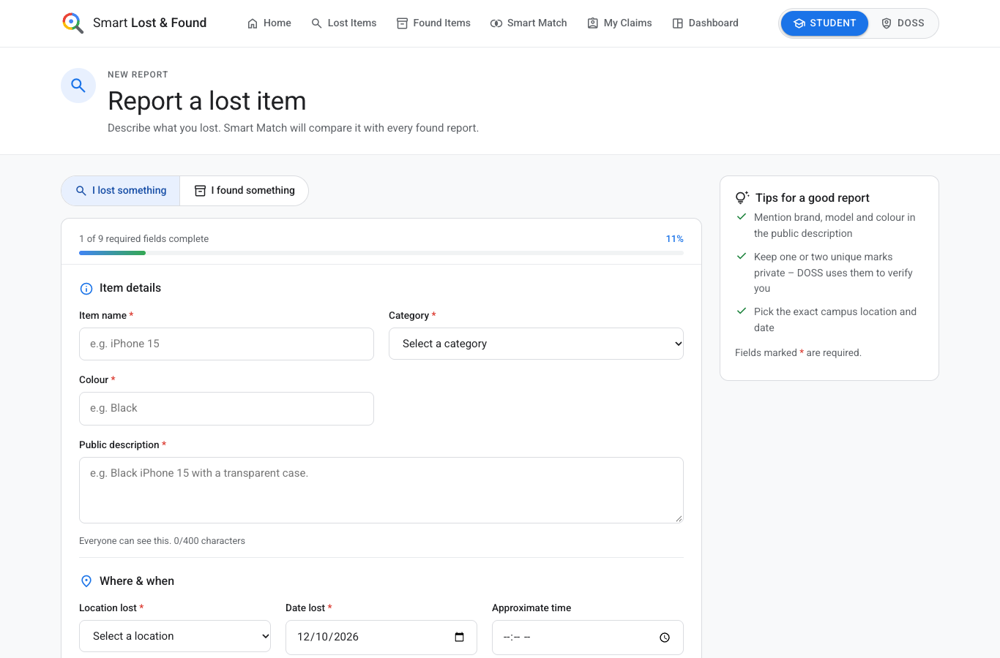

### Claim form – "This is my item"
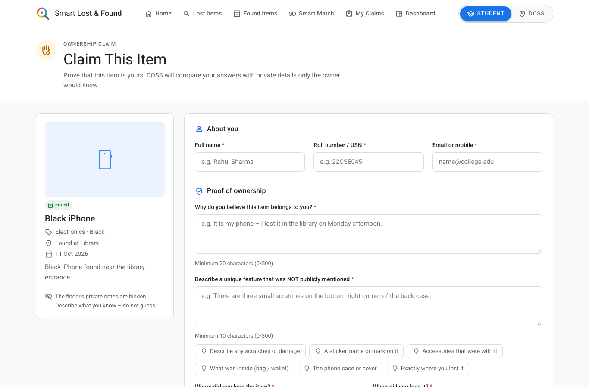

### Smart Match – scored matches with factors
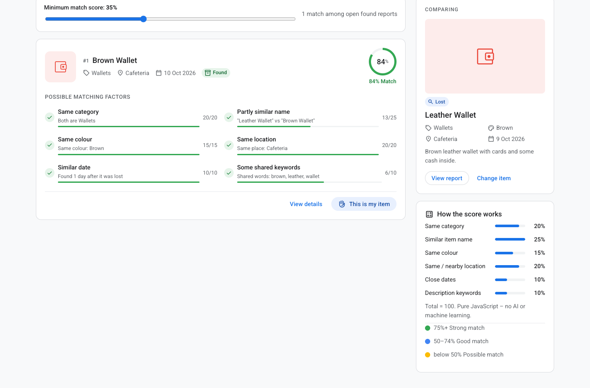

### My Claims – status tracker
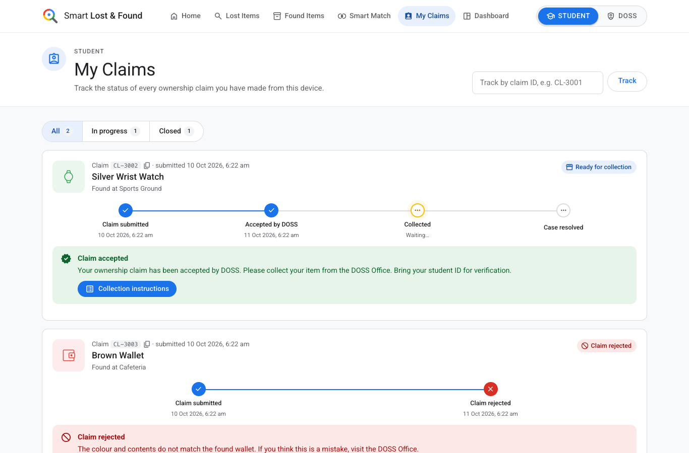

## DOSS staff

### Login (JWT)
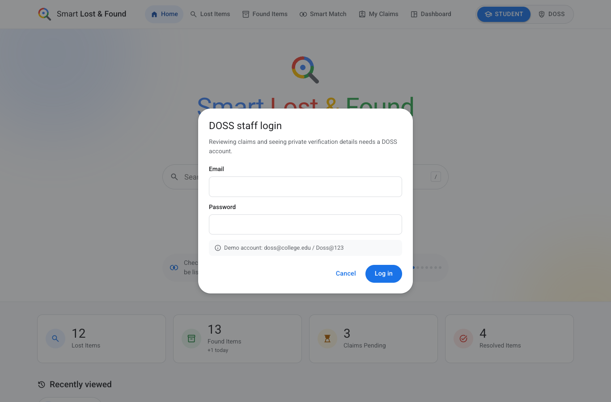

### DOSS dashboard
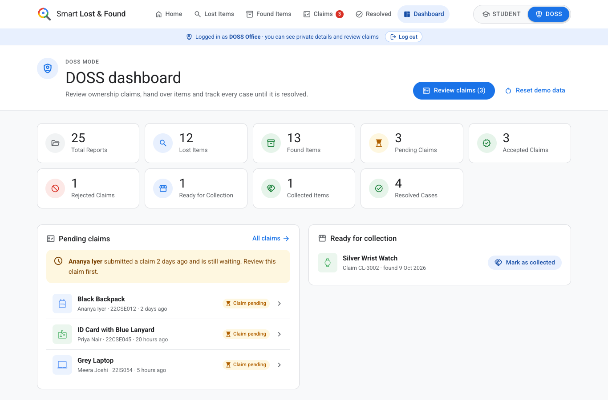

### Claims queue
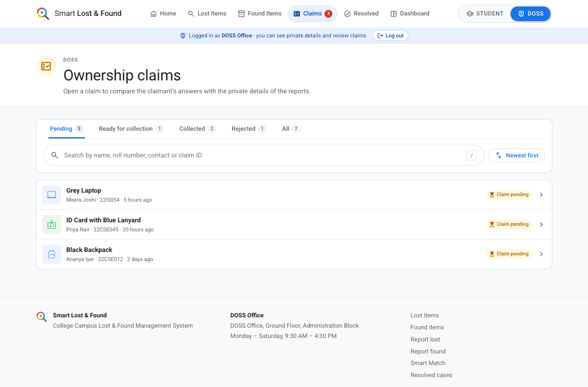

### Claim review – found report vs lost report, private details
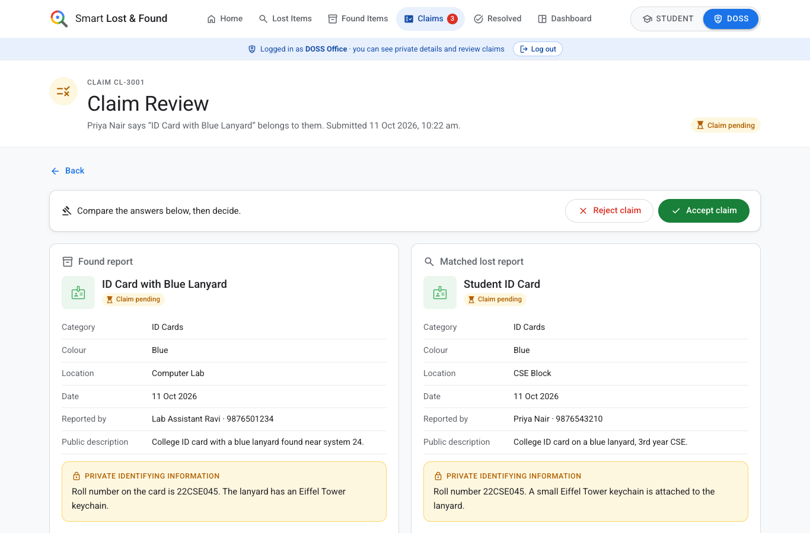

### Claim review – claimant's answers and verification helper
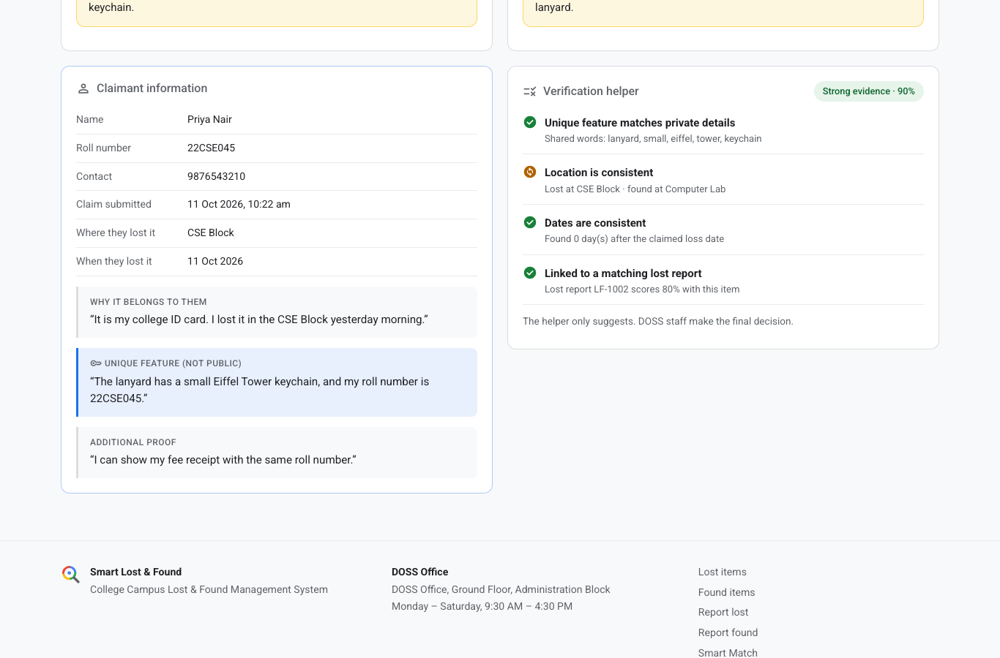

### Resolved cases
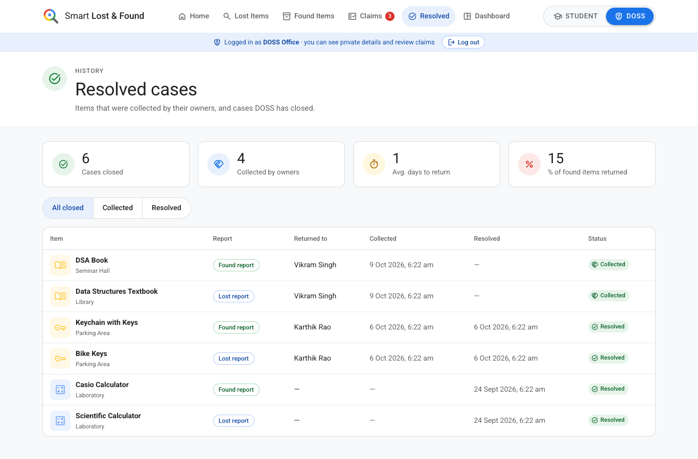

## Mobile

| Home | Found items |
|---|---|
| 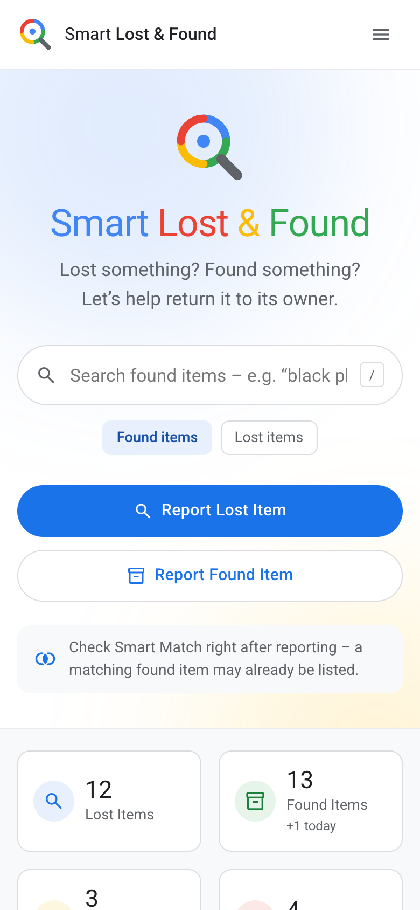 | 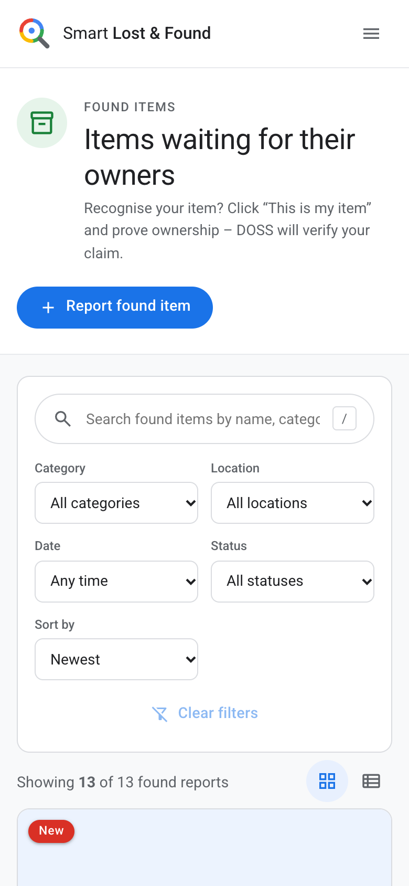 |

## Backend

### REST API response – `GET /api/items?type=found&search=black`
JSON returned by Express from MongoDB (no private details in the public response).

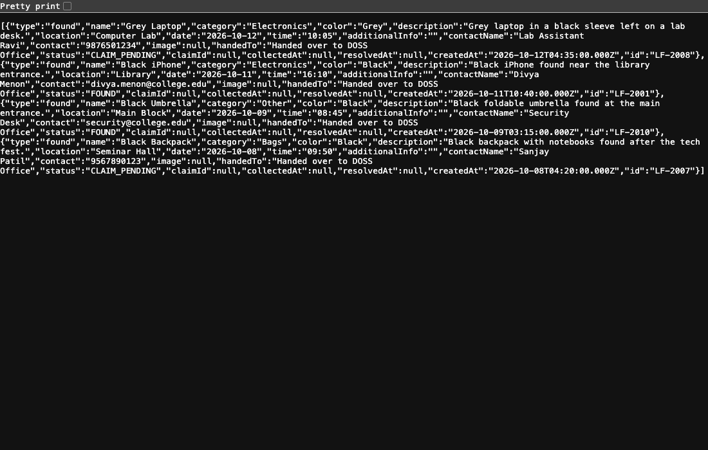
